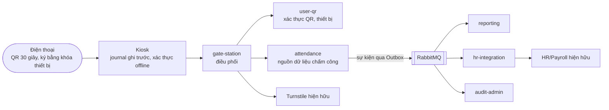

# TMC: hệ thống kiểm soát ra vào và chấm công bằng mã QR

Hệ thống cho TMC Manufacturing (hai nhà máy Bình Dương và Long An, khoảng 1.400 nhân viên): nhân viên đưa mã QR trên điện thoại vào đầu quét, hệ thống kiểm tra, mở cổng xoay, và ghi một giao dịch chấm công. Dữ liệu được chuyển sang HR/Payroll để đối soát trước 12:00 ngày 1 hằng tháng. Đây là bài tập môn Kiến trúc phần mềm (Assignment M2): thiết kế kiến trúc, áp dụng SOLID, và hiện thực module chính.

M2 bổ sung hai vấn đề phải giải quyết: **mất kết nối giữa chừng một giao dịch** và **QR tĩnh bị lộ**. Lời giải nằm ở [ADR-11](docs/adr/ADR-11-offline-first-store-and-forward.md) và [ADR-12](docs/adr/ADR-12-dynamic-qr-device-binding.md).

## Kiến trúc trong một hình



Microservices + Event-Driven (ADR-01, 02): đường quét QR chạy **đồng bộ tại biên** (nhà máy) để đáp ứng 2 giây; báo cáo, kiểm toán và đồng bộ HR chạy **bất đồng bộ** ở trung tâm. Mỗi service theo kiến trúc lục giác. Sơ đồ chi tiết: [docs/architecture/c4-edge.md](docs/architecture/c4-edge.md).

## Chạy thử trong 3 phút (không cần Docker)

Yêu cầu: JDK 21. Chi tiết: [docs/runbook/local-setup.md](docs/runbook/local-setup.md).

```bash
make build           # biên dịch và chạy test đơn vị và kiến trúc
make local-up        # khởi động turnstile giả lập, user-qr, attendance, gate-station
make demo-online     # quét, replay bị chặn, token giống QR tĩnh bị chặn, anti-passback
make local-restart && make demo-offline   # kiosk mất mạng, tự xác thực, giao journal sau
make local-restart && make demo-timeout   # cổng mở nhưng phản hồi mất: không mở hai lần, đối soát sau
make local-down
```

`make help` liệt kê mọi lệnh. Kịch bản demo giải thích từng bước: [docs/runbook/demo-scenarios.md](docs/runbook/demo-scenarios.md).

## Bản đồ kho mã

| Thư mục | Nội dung | Team |
| --- | --- | --- |
| `services/gate-station` | Điều phối luồng quét, chính sách ra vào, anti-passback, ACL tới Turnstile, mở thủ công | A |
| `services/attendance` | Nguồn dữ liệu chấm công, máy trạng thái lượt quét, Outbox, nhập offline, phục hồi, đối soát | B |
| `services/user-qr` | Xác thực QR theo khóa thiết bị, đăng ký và thu hồi thiết bị, gói đồng bộ | C |
| `services/identity` | Tài khoản nhân sự, khóa tài khoản, MFA (chưa cấp JWT) | C |
| `services/reporting`, `hr-integration`, `audit-admin` | Consumer phía trung tâm | D |
| `simulators/turnstile-simulator` | Turnstile giả có chèn lỗi | A |
| `simulators/device-simulator` | Điện thoại giả: sinh khóa, đăng ký, ký token QR | C |
| `simulators/kiosk-simulator` | Kiosk giả: journal SQLite, xác thực offline, giao batch | D |
| `apps/web-portal` | Guard Console và báo cáo (React) | D |
| `platform/*` | Thư viện dùng chung, **không chứa nghiệp vụ** | cả nhóm |
| `docker/`, `scripts/`, `.github/` | Hạ tầng, demo, CI | D |
| `docs/` | Báo cáo M1, ADR, kiến trúc, API, runbook, quy ước, kế hoạch team | cả nhóm |

## Tài liệu

| Bạn muốn | Đọc |
| --- | --- |
| Biết ai làm gì, khi nào | [docs/team/WORK-BREAKDOWN.md](docs/team/WORK-BREAKDOWN.md) |
| Đóng góp mã | [CONTRIBUTING.md](CONTRIBUTING.md), [docs/conventions/](docs/conventions/) |
| Hiểu quyết định kiến trúc | [docs/adr/](docs/adr/ADR-00-index.md) |
| Tìm lớp nào hiện thực SOLID | [docs/architecture/solid-map.md](docs/architecture/solid-map.md) |
| Biết mã khác ADR chỗ nào, còn thiếu gì | [docs/architecture/implementation-notes.md](docs/architecture/implementation-notes.md) |
| Máy trạng thái và 7 điểm đứt | [docs/architecture/state-machine.md](docs/architecture/state-machine.md) |
| Hợp đồng API và sự kiện | [docs/api/](docs/api/README.md) |
| Chạy, vận hành, xử lý sự cố | [docs/runbook/](docs/runbook/local-setup.md) |
| Nộp bài | [docs/runbook/release-checklist.md](docs/runbook/release-checklist.md) |
| Báo cáo M1 và đề M2 | [docs/document.md](docs/document.md), [docs/SA_CC_hk261_Assignment_M2.pdf](docs/SA_CC_hk261_Assignment_M2.pdf) |

## Tình trạng hiện tại (trung thực)

**Đã kiểm chứng:** build và toàn bộ test đơn vị, test kiến trúc của mọi module; ba kịch bản demo chạy trên bốn tiến trình thật qua HTTP (đường thành công và các từ chối, kiosk offline, timeout cổng có đối soát).

**Chưa kiểm chứng (cần Docker):** adapter PostgreSQL, Redis, RabbitMQ và migration; kiểm thử hiệu năng (2 giây ở tải đỉnh); mTLS. Việc kiểm chứng đầu tiên là story D-01.

**Đã biết còn thiếu và có người nhận:** [docs/architecture/implementation-notes.md](docs/architecture/implementation-notes.md) mục 3 đến 7. Đáng chú ý: anti-passback chưa cập nhật sau khi nhập offline (A-02), danh bạ nhân viên đang đọc từ cấu hình (C-02), identity chưa cấp JWT (C-04).

## Công nghệ

Java 21, Spring Boot 3.3, Gradle (Kotlin DSL) đa module, PostgreSQL 16, Redis 7, RabbitMQ 3.13, Nimbus JOSE (ES256), Flyway, ArchUnit, Testcontainers; picocli và SQLite cho công cụ mô phỏng; React 18, Vite, TypeScript cho portal.

## Nhóm thực hiện

4 team, mỗi team 2 người; danh sách và phân công ở [docs/team/WORK-BREAKDOWN.md](docs/team/WORK-BREAKDOWN.md).
