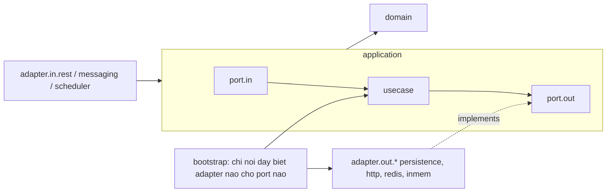

# Bản đồ module

Mỗi service là một module Gradle độc lập, theo kiến trúc lục giác (ports and adapters, M1 mục 11.3 và 16.1). **Quy tắc phụ thuộc được kiểm tra tự động** bởi `ArchitectureTest` trong từng service (dùng `platform/test-support`).

## Hướng phụ thuộc trong một service

| Quy tắc | Kiểm tra bởi |
| --- | --- |
| `domain` không phụ thuộc `application`, `adapter`, `bootstrap`, Spring, JPA | `HexagonalRules.domainIsIndependent` |
| `application` không phụ thuộc `adapter`, `bootstrap` | `HexagonalRules.applicationDoesNotDependOnAdapters` |
| Service không import mã của service khác | `HexagonalRules.noCrossServiceImports` |
| Chỉ `bootstrap` mới có `@Configuration` nối port với adapter | Quy ước, kiểm tra khi review |
| Lớp nghiệp vụ không có chú thích Spring | Quy ước, kiểm tra khi review |

## Catalog service

| Service | Cổng | Team | Gói gốc | Dữ liệu sở hữu | Port vào (driving) | Port ra (driven) chính |
| --- | --- | --- | --- | --- | --- | --- |
| `gate-station` | 8081 | A | `vn.tmc.gatestation` | Danh mục cổng, trạng thái anti-passback, giữ chỗ token (Redis) | `IGateAccess`, `IGateManualAccess`, `IGateObservation`, `IKioskSupport` | `IQRValidation`, `ITokenReservation`, `IAntiPassbackStore`, `IAttendanceGateway`, `ITurnstileControlPort`, `IGateConfigRepository`, `IEmployeeDirectory`, `IKioskSyncSource`, `IHeartbeatStore`, `IAuditLog` |
| `attendance` | 8082 | B | `vn.tmc.attendance` | `access_attempts`, `attendance_transactions`, `outbox_events` (PostgreSQL edge) | `IAttendanceCommand`, `IAttendanceQuery`, `IOfflineAttendanceIngest` | `IAttemptRepository`, `IAttendanceTransactionRepository`, `IOutboxRepository`, `ITransactionRunner`, `IGateStatusQuery`, `EventPublisher` |
| `user-qr` | 8083 | C | `vn.tmc.userqr` | `devices` (Device Key Registry) | `IQRValidation`, `IDeviceManagement`, `ISyncBundle` | `ITokenCodec`, `IDeviceKeyRegistry`, `IAuditLog` |
| `reporting` | 8084 | D | `vn.tmc.reporting` | Read model hiện diện | `IReporting` | `IPresenceRepository` |
| `hr-integration` | 8085 | D | `vn.tmc.hrintegration` | `sync_log` | `ISyncMonitoring` | `IHrPayrollPort`, `ISyncLogRepository` |
| `audit-admin` | 8086 | D | `vn.tmc.auditadmin` | Nhật ký kiểm toán (chỉ thêm) | `IAuditQuery` | `IAuditStore` (không có hàm sửa hay xóa) |
| `identity` | 8087 | C | `vn.tmc.identity` | Tài khoản nhân sự | `IAuthentication` | `IAccountRepository`, `IPasswordVerifier`, `IMfaVerifier` |
| `turnstile-simulator` | 8090 | A | `vn.tmc.turnstilesim` | Trạng thái cổng giả lập | REST `/gates/**`, `/admin/fault` | không |
| `kiosk-simulator` (CLI) | không | D | `vn.tmc.kiosksim` | Journal SQLite | CLI | `EdgeClient` |
| `device-simulator` (CLI) | không | C | `vn.tmc.devicesim` | Hồ sơ khóa (file) | CLI | không |

## Thư viện dùng chung (`platform/`): không chứa nghiệp vụ

| Module | Chứa | Không được chứa |
| --- | --- | --- |
| `common-kernel` | `IClock`, `Ids` (UUID v7), `ReasonCode`, `EventEnvelope`, `DomainEvent`, `Result` | Quy tắc nghiệp vụ của bất kỳ service nào |
| `messaging` | `EventPublisher`, `IdempotentConsumer`, `ProcessedMessageStore`, bản in-memory | Outbox, transaction, bảng dùng chung (mỗi service giữ outbox của mình) |
| `security` | `Role`, `DataScope`, `Principal`, `Rbac`, `PrincipalHeaders` | Dữ liệu tài khoản |
| `test-support` | Luật ArchUnit, phụ thuộc test chung | Mã sản xuất |

## Ánh xạ module sang thành phần M1

| Thành phần M1 (mục 11.2) | Module |
| --- | --- |
| Kiosk / QR Reader | `simulators/kiosk-simulator` (ứng dụng kiosk thật nằm ngoài phạm vi) |
| Web Portal / Mobile App | `apps/web-portal`; mobile app được mô phỏng bởi `apps/employee-app` (web, WebCrypto) và `device-simulator` (dòng lệnh) |
| API Gateway / Identity | `services/identity` (gateway: dùng header giả lập, xem `PrincipalHeaders`) |
| User / QR Service | `services/user-qr` |
| Gate Station Service (+ Turnstile Adapter) | `services/gate-station` (`adapter/out/http/HttpTurnstileAdapter`) |
| Attendance Service (+ Outbox, Publisher) | `services/attendance` |
| Reporting | `services/reporting` |
| HR Integration | `services/hr-integration` |
| Audit / Admin | `services/audit-admin` (module Admin: story còn lại ở FR-32, FR-35) |
| Message Broker | RabbitMQ (`docker/docker-compose.yml`) |
