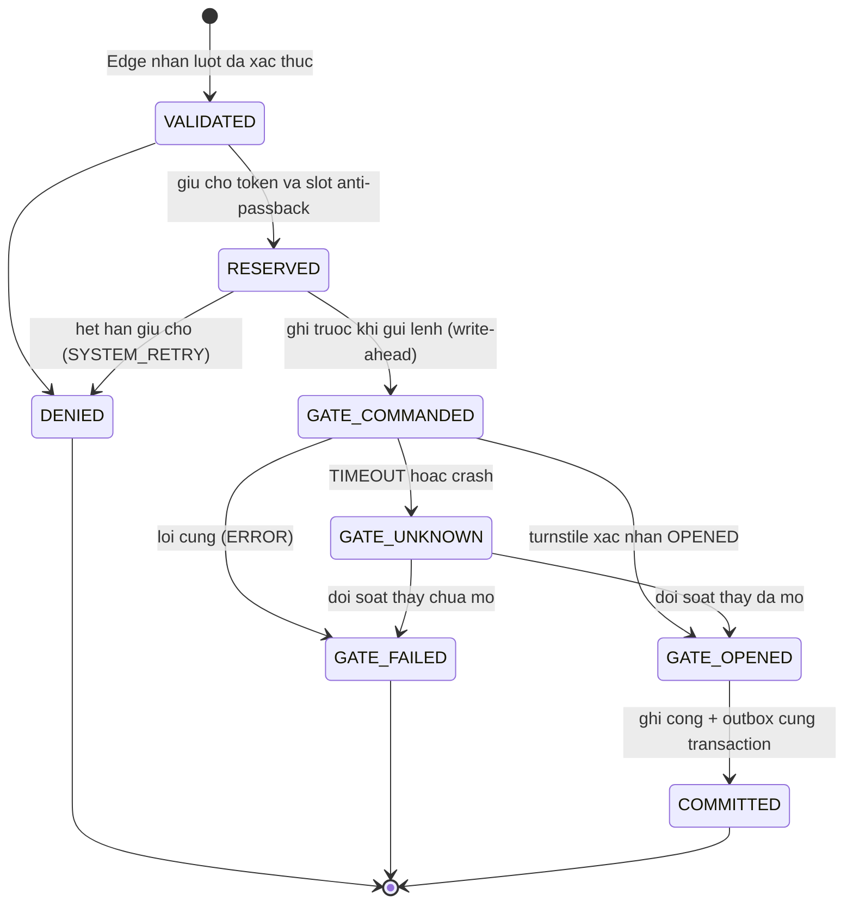

# Máy trạng thái của một lượt quét (ADR-11)

Nguồn sự thật là enum `AttemptStatus` và aggregate `AccessAttempt` trong `services/attendance/.../domain`. Mọi chuyển trạng thái đi qua các hàm của aggregate; chuyển sai ném `IllegalAttemptTransitionException` (HTTP 409).

`RECEIVED` chỉ tồn tại trong journal của kiosk. `PUBLISHED` là trạng thái của hàng outbox (`publish_status`), không phải của lượt quét (xem `implementation-notes.md` mục 1).

## Sự kiện phát ra theo bước

| Chuyển trạng thái | Sự kiện vào outbox |
| --- | --- |
| tạo `RESERVED` | `AccessAttemptRecorded` |
| `DENIED` do chính sách hoặc QR | `AuditRecorded` (`ACCESS_DENIED`) |
| `GATE_COMMANDED` | không có (chỉ là điểm ghi trước) |
| `OPENED`, `ERROR`, `UNKNOWN` | `GateResultRecorded` |
| `COMMITTED` (QR, không thủ công, không bất thường) | `AttendanceConfirmed` |
| `COMMITTED` với nguồn `MANUAL` | `AuditRecorded` (`MANUAL_OPEN_PENDING_VERIFICATION`), không tính công |
| nhập offline có bất thường | `AuditRecorded` (`TOKEN_REUSED_OFFLINE` hoặc `ANTI_PASSBACK_OFFLINE`) |

## 7 điểm đứt và nơi mã xử lý

| Điểm đứt | Tình huống | Xử lý trong mã | Test chứng minh |
| --- | --- | --- | --- |
| P1 | Kiosk gửi, không nhận phản hồi | Kiosk gửi lại **cùng `attempt_id`**; Edge trả kết quả đã lưu | `RecordScanUseCaseTest.should_answer_a_retry_from_the_stored_result_and_open_the_gate_only_once`, `KioskAppTest.should_retry_with_the_same_attempt_id_...` |
| P2 | Đã giữ chỗ rồi crash | `RecoverStaleAttemptsUseCase` chuyển `RESERVED` quá hạn sang `DENIED/SYSTEM_RETRY` | `Adr11ResilienceTest.should_release_a_stale_reservation_as_denied_system_retry` |
| P3 | Gửi lệnh mở, không có phản hồi | Ghi `GATE_UNKNOWN`, **không gửi lại lệnh**; `ReconcileUnknownUseCase` hỏi cổng | `RecordScanUseCaseTest.should_record_unknown_on_timeout_and_never_resend_...`, `Adr11ResilienceTest.should_keep_unknown_then_commit_...` |
| P4 | Cổng đã mở, chưa commit | `GATE_COMMANDED` đã bền vững trước khi gửi; phục hồi chuyển sang `GATE_UNKNOWN` rồi đối soát | `Adr11ResilienceTest.should_recover_a_crashed_attempt_through_unknown_into_committed` |
| P5 | Đã commit, kiosk không nhận | Kiosk gửi lại, Edge trả `COMMITTED` đã có | `RecordScanUseCaseTest.should_answer_unconfirmed_...` và kiểm thử gửi lại |
| P6 | LAN giữa kiosk và Edge đứt | Kiosk xác thực cục bộ, ghi journal trước, mở qua local gate link; sau đó `flush` | `KioskAppTest.should_verify_locally_open_through_the_local_link_and_journal_...`, `Adr11ResilienceTest` (nhập offline) |
| P7 | WAN hoặc broker đứt | Outbox giữ `PENDING`, phát lại, consumer khử trùng theo `messageId` | `Adr11ResilienceTest.should_keep_events_pending_while_the_broker_is_down_...` |

Kịch bản chạy thật: `make demo-timeout` (P3) và `make demo-offline` (P6). Xem `docs/runbook/demo-scenarios.md`.

## Journal của kiosk

| `status` | Ý nghĩa | `handed_over` |
| --- | --- | --- |
| `RECEIVED` | Đã ghi, chưa có quyết định | 0 |
| `OPENED`, `DENIED`, `PENDING` | Edge đã trả lời hoặc đang sở hữu lượt | 1 |
| `OFFLINE_OPENED` | Kiosk tự xác thực và mở qua local gate link | 0 cho đến khi `flush` |
| `OFFLINE_DENIED` | Kiosk tự từ chối (ghi để audit) | 0 cho đến khi `flush` |
