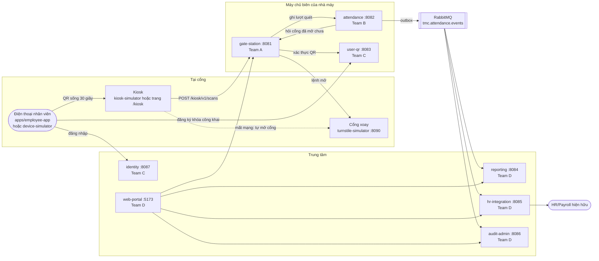
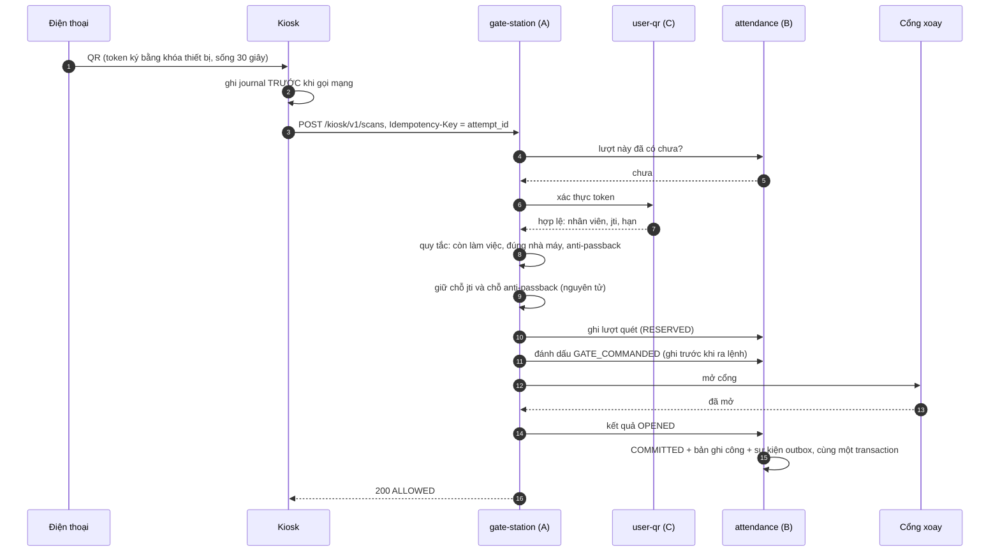
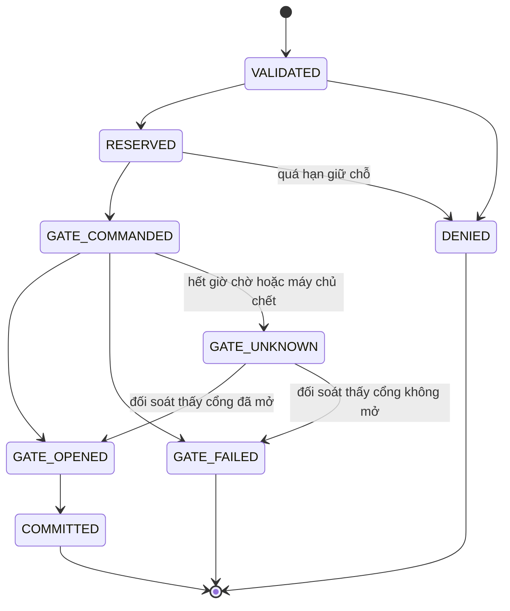
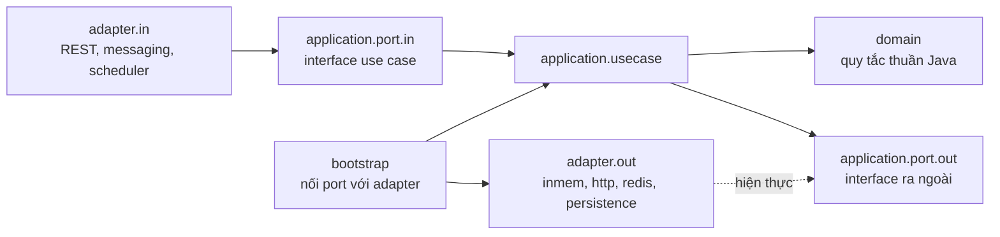

# Tổng quan hệ thống TMC

Tài liệu này dành cho người chưa đọc mã. Đọc xong, bạn biết hệ thống làm gì, gồm những phần nào, phần nào của team nào, và một lượt quét đi qua đâu.

## 1. Bài toán

TMC có 2 nhà máy (Bình Dương `BD`, Long An `LA`) với khoảng 1.400 nhân viên. Nhân viên đưa mã QR trên điện thoại vào máy quét ở cổng; cổng xoay mở và lượt ra vào trở thành dữ liệu chấm công.

Ba ràng buộc chi phối toàn bộ thiết kế:

| Ràng buộc | Con số | Hệ quả thiết kế |
| --- | --- | --- |
| Một lượt quét phải nhanh | Tối đa 2 giây | Quyết định mở cổng được đưa ra **tại nhà máy** (edge), không chờ trung tâm |
| Mạng nhà máy có thể đứt | Cổng vẫn phải hoạt động | Kiosk tự xác thực và ghi sổ khi mất mạng, gửi lên sau (ADR-11) |
| Lương chốt đúng hạn | 12:00 ngày 1 hằng tháng | Sự kiện chấm công không được mất, không được đếm hai lần (outbox, khóa lũy đẳng) |

M2 phải giải quyết hai vấn đề mà bản thiết kế M1 còn hở:

1. **Mất kết nối giữa chừng** một lượt quét (cổng đã mở mà chưa ghi công, hoặc ngược lại). Lời giải: [ADR-11](../adr/ADR-11-offline-first-store-and-forward.md).
2. **QR tĩnh** có thể chụp màn hình rồi dùng lại hoặc đưa cho người khác. Lời giải: [ADR-12](../adr/ADR-12-dynamic-qr-device-binding.md).

## 2. Các thành phần

| Thành phần | Cổng | Team | Việc nó làm | Dữ liệu nó giữ |
| --- | --- | --- | --- | --- |
| `gate-station` | 8081 | A | Điều phối một lượt quét: gọi xác thực QR, áp quy tắc ra vào, giữ chỗ token, ra lệnh mở cổng | Danh mục cổng, trạng thái anti-passback, token đã dùng (Redis) |
| `attendance` | 8082 | B | Sổ ghi mọi lượt quét, máy trạng thái của lượt quét, phát sự kiện qua outbox | `access_attempts`, `attendance_transactions`, `outbox_events` (PostgreSQL) |
| `user-qr` | 8083 | C | Giữ khóa công khai của từng điện thoại, xác thực chữ ký và thời hạn của QR | `devices` (PostgreSQL) |
| `identity` | 8087 | C | Đăng nhập, khóa tài khoản sau 5 lần sai, MFA | Tài khoản |
| `reporting` | 8084 | D | Ai đang ở trong nhà máy, báo cáo, quy tắc phát hiện gian lận | Read model hiện diện |
| `hr-integration` | 8085 | D | Đẩy công sang HR/Payroll, theo dõi trạng thái đồng bộ | `sync_log` |
| `audit-admin` | 8086 | D | Nhật ký kiểm toán chỉ thêm, không sửa, không xóa | Nhật ký |
| `turnstile-simulator` | 8090 | A | Giả lập hệ thống điều khiển cổng xoay, chèn được lỗi | Trạng thái cổng |
| `kiosk-simulator` | CLI | D | Giả lập kiosk đầy đủ: journal, chế độ mất mạng, gửi bù | SQLite |
| `device-simulator` | CLI | C | Giả lập điện thoại: tạo khóa, ký token | File khóa |
| `apps/employee-app` | 5174 | D (C phối hợp) | Ứng dụng web cho nhân viên: đăng nhập, hiện QR; kèm trang `/kiosk` quét bằng webcam | Khóa riêng trong trình duyệt |
| `apps/web-portal` | 5173 | D | Cổng thông tin cho bảo vệ, quản đốc, HR | Không |

Thư viện dùng chung trong `platform/` (không chứa nghiệp vụ): `common-kernel` (đồng hồ, UUID v7, `ReasonCode`, `EventEnvelope`), `messaging` (`EventPublisher`, `IdempotentConsumer`), `security` (`Role`, `Principal`, `Rbac`), `test-support` (luật ArchUnit).

## 3. Một lượt quét, từ đầu đến cuối

Lớp điều phối là [`RecordScanUseCase`](../../services/gate-station/src/main/java/vn/tmc/gatestation/application/usecase/RecordScanUseCase.java). Đọc lớp này là hiểu được nửa hệ thống.

Bốn điều phải nhớ:

- **`attempt_id` là khóa lũy đẳng xuyên suốt.** Kiosk sinh nó, gửi lại bao nhiêu lần cũng chỉ ra một lượt quét và cổng chỉ mở một lần.
- **Ghi trước, làm sau.** Trạng thái `GATE_COMMANDED` được lưu trước khi lệnh mở rời máy chủ. Nếu máy chủ chết giữa chừng, lúc khởi động lại nó biết lệnh có thể đã được gửi.
- **Hết giờ chờ nghĩa là "chưa biết", không phải "thất bại".** Hệ thống không bao giờ gửi lại lệnh mở. Nó hỏi cổng "lệnh kia đã làm gì" rồi mới chốt.
- **Mọi lối thoát sớm đều nhả những gì đã giữ.** Cổng báo lỗi thì token được nhả để nhân viên quét lại.

## 4. Máy trạng thái của một lượt quét

Định nghĩa trong [`AccessAttempt`](../../services/attendance/src/main/java/vn/tmc/attendance/domain/AccessAttempt.java), chi tiết ở [`state-machine.md`](../architecture/state-machine.md).

Chỉ lượt `COMMITTED`, không có cờ bất thường và không phải mở thủ công, mới được tính công.

## 5. Hai cơ chế cốt lõi của M2

### 5.1. Chịu được mất kết nối (ADR-11)

Bảy điểm có thể đứt và cách hệ thống xử lý:

| Điểm đứt | Tình huống | Xử lý | Nơi hiện thực |
| --- | --- | --- | --- |
| P1 | Kiosk gửi, không nhận được trả lời | Gửi lại cùng `attempt_id`, nhận lại kết quả cũ | `RecordScanUseCase.replay` |
| P2 | Đã giữ chỗ, chưa ra lệnh thì chết | Hàng `RESERVED` quá 30 giây bị nhả | `RecoverStaleAttemptsUseCase` |
| P3 | Đã ra lệnh, cổng không trả lời | `GATE_UNKNOWN`, hỏi lại cổng, không gửi lệnh lần hai | `ReconcileUnknownUseCase`, `ObserveGateUseCase` |
| P4 | Đã ra lệnh thì máy chủ chết | Hàng `GATE_COMMANDED` quá 10 giây thành `GATE_UNKNOWN` | `RecoverStaleAttemptsUseCase` |
| P5 | Cổng đã mở, chưa lưu được kết quả | Trả `UNCONFIRMED`, phục hồi sẽ hoàn tất | `RecordScanUseCase.onOpened` |
| P6 | Kiosk mất mạng tới máy chủ biên | Kiosk tự xác thực, tự mở cổng, ghi journal, gửi bù sau | `kiosk-simulator`, `IngestOfflineBatchUseCase` |
| P7 | Đã lưu công, broker chết | Sự kiện nằm trong outbox, phát lại khi broker sống | `PublishOutboxUseCase` |

### 5.2. QR động gắn với thiết bị (ADR-12)

Mỗi điện thoại có một cặp khóa. Khóa riêng không rời máy; khóa công khai được đăng ký ở `user-qr`. Mỗi QR là một token do điện thoại tự ký:

| Phần | Nội dung |
| --- | --- |
| Header | `alg: ES256`, `kid` = mã thiết bị |
| Claims | `sub` (UUID nhân viên), `jti` (mã dùng một lần), `iat`, `exp` (30 giây sau), `fac` (nhà máy), `nonce` |
| Cấm | Mọi claim khác, kể cả họ tên (ADR-09) |

Bốn lớp chống dùng lại:

| Lớp | Cơ chế | Ở đâu | Hiện trạng |
| --- | --- | --- | --- |
| R1 | Giữ chỗ `jti` nguyên tử (`SET NX`) | `ITokenReservation` của gate-station | Chạy được bằng bộ nhớ; bản Redis chờ kiểm chứng (A-01) |
| R2 | Bộ nhớ đệm `jti` tại kiosk khi mất mạng | `kiosk-simulator` | Có |
| R3 | Phát hiện cùng `jti` ở hai kiosk khi nhập lô offline | `IngestOfflineBatchUseCase` | Có |
| R4 | Quy tắc gian lận (ví dụ BD rồi LA cách 10 phút) | `FraudRule` của reporting | Mới có interface (D-05) |

## 6. Sự kiện giữa biên và trung tâm

`attendance` là nơi duy nhất phát sự kiện. Mỗi thay đổi trạng thái và sự kiện tương ứng được ghi trong cùng một transaction (outbox), rồi một tác vụ nền đẩy lên RabbitMQ. Hợp đồng: [`attendance-events.asyncapi.yaml`](../api/attendance-events.asyncapi.yaml).

| Sự kiện | Khi nào | Ai nghe |
| --- | --- | --- |
| `AccessAttemptRecorded` | Lượt quét được ghi nhận | reporting |
| `GateResultRecorded` | Có kết quả từ cổng | reporting |
| `AttendanceConfirmed` | Lượt quét thành công được tính công | reporting, hr-integration |
| `AuditRecorded` | Từ chối, bất thường, mở thủ công | audit-admin |
| `AttendanceCorrected` | HR hiệu chỉnh (chưa có, B-06) | reporting, hr-integration |

Bên nghe phải lũy đẳng: cùng một thông điệp đến hai lần chỉ được xử lý một lần (`IdempotentConsumer`).

## 7. Bên trong một service

Cả 7 service cùng một khuôn (kiến trúc lục giác). Biết khuôn này thì đọc service nào cũng được.

| Gói | Chứa | Không được |
| --- | --- | --- |
| `domain` | Thực thể và quy tắc nghiệp vụ | Phụ thuộc Spring, JPA, hay bất kỳ gói nào khác |
| `application.port.in` | Interface mà bên ngoài gọi vào | |
| `application.usecase` | Luồng nghiệp vụ | Có chú thích Spring; gọi thẳng adapter |
| `application.port.out` | Interface mà use case cần ở bên ngoài | |
| `adapter.in.*` | Controller, listener, scheduler | Chứa quy tắc nghiệp vụ |
| `adapter.out.*` | Hiện thực port ra: `inmem` (test và local), `http`, `redis`, `persistence`, `messaging` | |
| `bootstrap` | Lớp `@Configuration` chọn adapter theo profile | |

Luật phụ thuộc được kiểm bằng test: mỗi service có `ArchitectureTest` chạy `HexagonalRules`. Vi phạm thì build đỏ.

**Service không import mã của service khác.** Chúng nói chuyện qua HTTP hoặc sự kiện, theo hợp đồng trong `docs/api`. Vì vậy mỗi team sửa service của mình mà không làm vỡ build của team khác, miễn là giữ hợp đồng.

## 8. Ba profile chạy

| Profile | Lưu trữ | Gọi service khác | Dùng khi |
| --- | --- | --- | --- |
| `inmem` | Bộ nhớ | Không, dùng bản giả | Test tự động, chạy một service đơn lẻ |
| `local` | Bộ nhớ | HTTP thật | Dựng cả stack trên máy mà không cần Docker; demo |
| mặc định | PostgreSQL, Redis, RabbitMQ | HTTP thật, sự kiện thật | Kiểm thử tích hợp (cần Docker) |

Lưu ý: ở `inmem` và `local`, sự kiện không đi qua tiến trình khác, nên `reporting`, `hr-integration`, `audit-admin` chỉ nhận được sự kiện khi chạy profile mặc định với RabbitMQ.

## 9. Danh tính và phân quyền, hiện tại và đích đến

| | Hiện tại | Đích đến (C-04, C-06) |
| --- | --- | --- |
| Đăng nhập | `POST /auth/v1/login` trả `status`, `subject`, `roles` | Trả JWT ký ES256, có JWKS |
| Gọi API | Client tự gửi header `X-Subject`, `X-Roles`, `X-Scope-*` | Service xác thực JWT |
| Kiểm quyền | Service tự kiểm bằng `Rbac` (đã có) | Không đổi |

Header danh tính hiện tại **không an toàn**, chỉ để phát triển. Đừng mô tả nó như cơ chế bảo mật trong báo cáo.

## 10. Bảng mã lý do thường gặp

Định nghĩa đầy đủ: [`ReasonCode`](../../platform/common-kernel/src/main/java/vn/tmc/platform/kernel/ReasonCode.java).

| Mã | Nghĩa | Ai quyết định |
| --- | --- | --- |
| `QR_EXPIRED` | Token quá hạn (kể cả 60 giây lệch đồng hồ) | user-qr |
| `QR_ALREADY_USED` | `jti` đã được dùng hoặc đang được giữ | gate-station |
| `INVALID_SIGNATURE` | Chữ ký sai, hoặc thiết bị ký thay người khác | user-qr |
| `MALFORMED_TOKEN` | Sai định dạng, sống quá 60 giây, hoặc có claim cấm | user-qr |
| `DEVICE_UNKNOWN`, `DEVICE_REVOKED` | Thiết bị chưa đăng ký hoặc đã thu hồi | user-qr |
| `EMPLOYEE_INACTIVE`, `FACTORY_NOT_PERMITTED` | Nhân viên nghỉ việc, hoặc không được vào nhà máy này | gate-station |
| `ANTI_PASSBACK_VIOLATION` | Hai lượt cùng chiều liên tiếp, hoặc hai lượt quét cùng lúc | gate-station |
| `TURNSTILE_TIMEOUT_RETRY_SCAN` | Cổng chưa trả lời, đang đối soát | gate-station |
| `GATE_HARDWARE_ERROR` | Cổng báo lỗi, token đã được nhả | gate-station |

## 11. Đọc mã theo thứ tự nào

1. `services/gate-station/.../usecase/RecordScanUseCase.java`: luồng chính.
2. `services/attendance/.../domain/AccessAttempt.java` và `AttemptStatus.java`: máy trạng thái.
3. `services/attendance/.../usecase/AttendanceCommandService.java` và `GateResultApplier.java`: ghi công và outbox.
4. `services/user-qr/.../usecase/VerifyQrTokenUseCase.java` và `domain/TokenVerificationPolicy.java`: xác thực QR.
5. `simulators/kiosk-simulator/.../KioskApp.java`: kiosk và chế độ mất mạng.
6. `services/attendance/.../usecase/IngestOfflineBatchUseCase.java`, `RecoverStaleAttemptsUseCase.java`, `ReconcileUnknownUseCase.java`: phục hồi.
7. Test đi kèm: `RecordScanUseCaseTest`, `Adr11ResilienceTest`, `Adr12TokenVerificationTest`. Tên test đọc như đặc tả.

Bản trực quan có tương tác của phần này: <https://claude.ai/artifact/9TmRcCsp6WBTcApZQfZPt7> (trang riêng tư, người tạo cần chia sẻ thì người khác mới mở được).
