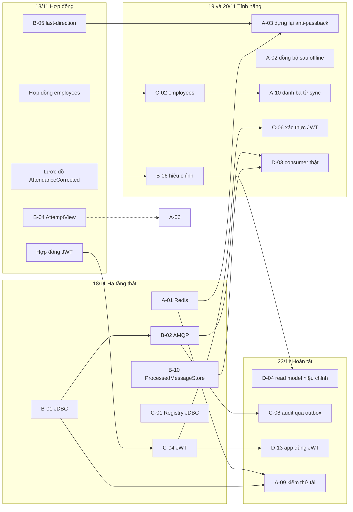

# Kế hoạch 10 ngày: 12/11 đến 25/11/2026

Tài liệu này trả lời: việc nào làm trước, việc nào làm sau, team nào chờ team nào, và làm gì khi thứ mình chờ bị trễ.

## 1. Lịch và mốc

| Ngày | Thứ | Ký hiệu | Hạn | Mốc |
| --- | --- | --- | --- | --- |
| 12/11 | Năm | N1 | 23:00 | **M0 Khởi động:** ai cũng chạy được stack local, 3 demo và app nhân viên |
| 13/11 | Sáu | N2 | 23:00 | **M1 Đóng băng hợp đồng:** `docs/api` khớp mã và đã có các trường, endpoint mới sẽ dùng |
| 16/11 | Hai | N3 | 23:00 | CI chạy trên mọi PR |
| 17/11 | Ba | N4 | 23:00 | |
| 18/11 | Tư | N5 | 23:00 | **M2 Hạ tầng thật:** Redis, PostgreSQL, RabbitMQ đã được kiểm chứng; JWT đã cấp được |
| 19/11 | Năm | N6 | 23:00 | |
| 20/11 | Sáu | N7 | 23:00 | Nộp bản nháp phần báo cáo của từng team |
| 23/11 | Hai | N8 | 23:00 | **M3 Đủ tính năng:** mọi story bắt buộc đã hợp nhất |
| 24/11 | Ba | N9 | 23:00 | **M4 Đóng băng mã:** chỉ sửa lỗi; tổng duyệt demo; báo cáo đủ nội dung |
| 25/11 | Tư | N10 | 23:00 | **M5 Nộp:** PDF báo cáo, URL GitHub, gắn tag |

**Quy ước về giờ:** mọi hạn trong bộ tài liệu này là **23:00 của ngày được ghi** (giờ Việt Nam). "Xong" nghĩa là PR đã hợp nhất vào `main` trước 23:00, không phải mới mở PR. Việc nào hợp nhất sau 23:00 được tính là trễ sang ngày hôm sau, và lead phải báo trong họp đứng sáng kế tiếp.

Biểu đồ Gantt của toàn bộ lịch: [03-gantt.md](03-gantt.md).

Hai ngày cuối tuần (14 và 15/11, 21 và 22/11) không xếp việc. Đó là phần dự phòng duy nhất, nên đừng tiêu nó từ đầu.

## 2. Nguyên tắc để không team nào bị chặn

Lịch này ngắn, nên cách chia việc dựa trên ba nguyên tắc.

**Hợp đồng trước, hiện thực sau.** Thứ team khác cần ở mình hầu hết là *hình dạng* của API hoặc sự kiện, chưa cần phần ruột. Vì vậy mọi thay đổi hợp đồng phải vào `docs/api` trước 23:00 ngày 13/11 (M1). Sau mốc đó, bên dùng viết mã dựa trên hợp đồng và một bản giả, không cần chờ bên cung cấp xong.

**Việc mở khóa cho team khác làm đầu tiên.** Những story nhỏ mà team khác đang chờ (B-04, B-05, hợp đồng của C-02 và C-04) được xếp vào hai ngày đầu, trước cả việc lớn của chính team đó.

**Mỗi phụ thuộc có sẵn phương án thay thế.** Bảng ở mục 4 ghi rõ: nếu thứ bạn chờ chưa tới thì dùng gì để làm tiếp. Không ai được ngồi chờ.

Ngoài ra, các service không import mã của nhau, nên bốn team sửa song song mà không xung đột build. Chỗ dễ xung đột là `docs/api` và `platform/*`; mọi PR chạm vào hai nơi này cần thêm một người duyệt từ team bị ảnh hưởng.

## 3. Ai làm gì, ngày nào

Chữ **đậm** là việc team khác đang chờ. Mỗi team có hai người, ký hiệu 1 (lead) và 2.

| Ngày | Team A (Gate Station) | Team B (Attendance) | Team C (QR, Identity) | Team D (Kiosk, Portal, Central) |
| --- | --- | --- | --- | --- |
| **N1** 12/11 | Dựng máy. A-05 (A2). Rà OpenAPI kiosk, turnstile (A1) | Dựng máy. **B-05** (B1), **B-04** (B2) | Dựng máy. **Hợp đồng JWT của C-04** (C1). C-10 bắt đầu (C2) | Dựng máy. **D-01** (D1). **D-02** bắt đầu (D2). D-14 (D2) |
| **N2** 13/11 | Thiết kế bảng và API của A-04, đưa vào OpenAPI (A1). Khung test A-01 (A2) | **Hợp nhất B-04, B-05.** Thêm `AttendanceCorrected` vào AsyncAPI (B1) | **Hợp đồng `employees` của C-02** vào OpenAPI (C2). C-04 bắt đầu (C1) | Rà AsyncAPI với B. **D-02** tiếp (D2). Khung D-06 (D1) |
| **N3** 16/11 | A-01 (A2). A-04 (A1) | B-01 (B1). **B-02** bắt đầu (B2) | C-04 (C1). C-01 (C2) | **D-02 xong.** D-06 (D1). D-05 (D2) |
| **N4** 17/11 | **A-01 xong.** A-04 (A1) | **B-01 xong** (B1). B-02 (B2) | C-04 (C1). **C-01 xong**, C-02 bắt đầu (C2) | D-06 (D1). **D-05 xong** (D2) |
| **N5** 18/11 | A-03 (A2). A-04 (A1) | B-06 bắt đầu (B1). **B-02 xong. B-10 xong** (B2) | **C-04 xong.** C-02 (C2) | **D-06 xong.** D-08 (D2) |
| **N6** 19/11 | **A-03 xong.** A-02 bắt đầu (A2). **A-04 xong** | B-06 (B1). B-03 (B2) | C-06 (C1). **C-02 xong** | D-03 (cả hai) |
| **N7** 20/11 | **A-02 xong.** A-10 (A1). A-06 (A1). Bản nháp báo cáo | **B-06 xong. B-03 xong.** Bản nháp báo cáo | **C-06 xong.** C-05 (C2). C-10 xong. Bản nháp báo cáo | **D-03 xong.** D-07 (D1). Bản nháp báo cáo |
| **N8** 23/11 | A-09 (cả hai) | B-08. Hỗ trợ D-04, sửa lỗi | C-08 (C1). D-13 cùng Team D (C2) | D-04 (D2). D-12 bắt đầu (D1). D-13 |
| **N9** 24/11 | Sửa lỗi. Tổng duyệt demo | Sửa lỗi. Tổng duyệt demo | Sửa lỗi. Tổng duyệt demo | **D-12.** Tổng duyệt demo |
| **N10** 25/11 | Rà báo cáo | Rà báo cáo | Rà báo cáo | **Nộp** |

Nội dung và tiêu chí hoàn thành của từng story nằm trong tài liệu của từng team.

## 4. Bàn giao giữa các team

Đây là danh sách đầy đủ những thứ một team nợ team khác. Lead của bên giao báo trong họp đứng khi giao xong; lead của bên nhận xác nhận đã dùng được.

| # | Hạn (23:00) | Bên giao | Bên nhận | Thứ được giao | Nếu trễ, bên nhận làm gì |
| --- | --- | --- | --- | --- | --- |
| H1 | 12/11 | D (D-01) | A, B, C | `docker compose up` chạy được trên máy của cả nhóm; ghi chú lỗi nếu có | Test tích hợp dùng Testcontainers, không phụ thuộc compose |
| H2 | 13/11 | B (B-05) | A | `GET /internal/v1/employees/{uuid}/last-direction` và mô tả trong OpenAPI | A viết A-03 dựa trên hợp đồng, thêm phương thức tương ứng vào `FakeAttendanceGateway` |
| H3 | 13/11 | B (B-04) | A | `AttemptView` có thêm `direction`, `employeeUuid` | A-06 là việc nên có; hoãn, không chặn việc khác |
| H4 | 13/11 | B | D, C | Lược đồ `AttendanceCorrected` trong AsyncAPI | D viết D-04 dựa trên lược đồ, tự tạo sự kiện mẫu trong test |
| H5 | 13/11 | C (C-04) | A, B, D | Tài liệu hợp đồng JWT: các claim, thuật toán, đường dẫn JWKS, cặp khóa dùng cho test | Tiếp tục dùng header `X-Subject` |
| H6 | 13/11 | C (C-02) | A | Trường `employees` trong sync bundle, mô tả trong OpenAPI | A viết A-10 dựa trên hợp đồng, dùng JSON mẫu |
| H7 | 16/11 | D (D-02) | A, B, C | CI (đã có, chạy trên mọi lần đẩy) xanh trên GitHub; nhánh `main` được bảo vệ | Mỗi người tự chạy `./gradlew spotlessApply test` trước khi mở PR |
| H8 | 18/11 | B (B-02) | D, C | Outbox đã phát được lên RabbitMQ thật; tên exchange và khóa định tuyến đã chốt | D-03 không cần publisher của B: test tự đẩy `EventEnvelope` lên RabbitMQ bằng `RabbitTemplate`. C-08 lùi sang 23/11 hoặc cắt |
| H9 | 18/11 | B (B-10) | D | `JdbcProcessedMessageStore` trong `platform/messaging` kèm test | D-03 dùng `InMemoryProcessedMessageStore` cho phần DLQ và retry, nối bản JDBC sau |
| H10 | 18/11 | C (C-04) | D, C | `identity` cấp JWT và có JWKS | D-13 bị cắt; app nhân viên giữ header `X-Subject` |
| H11 | 19/11 | C (C-02) | A | Sync bundle trả `employees` thật | A-10 dùng JSON mẫu, nối thật sau; hoặc cắt A-10 và giữ danh bạ từ `application.yml` |
| H12 | 20/11 | B (B-06) | D | `AttendanceCorrected` được phát thật | D-04 chỉ kiểm bằng sự kiện mẫu trong test |
| H13 | 20/11 | A, B, C, D | D | Bản nháp phần báo cáo của từng team, dạng Markdown trong `docs/report/` | D hợp nhất phần đã có, phần thiếu ghi "chưa nộp" và báo lead |
| H14 | 23/11 | Tất cả | Tất cả | Mọi story bắt buộc đã hợp nhất vào `main` | Họp lead ngay trong ngày để quyết định cắt |

**Đường găng:** B-01 rồi B-02 (18/11) rồi D-03 (20/11). Chậm ở đây thì chậm cả phần trung tâm. Lead Team B báo tình trạng B-02 mỗi sáng từ 16/11.

## 5. Phạm vi

So với kế hoạch 4 tuần, lịch 10 ngày chỉ giữ các story bắt buộc và thu nhỏ một số story lớn.

### 5.1. Giữ lại

| Team | Story | Ghi chú |
| --- | --- | --- |
| A | A-01, A-02, A-03, A-04, A-09 | Bắt buộc |
| A | A-05, A-06, A-10 | Nên có; A-10 là phần Gate Station của C-02 |
| B | B-01, B-02, B-03, B-05, B-06 | Bắt buộc |
| B | B-04, B-08, B-10 | B-10 mới: tách từ D-03 để cân tải |
| C | C-01, C-02, C-04, C-10 | Bắt buộc |
| C | C-05, C-06, C-08 | Bắt buộc theo đề nhưng **cắt đầu tiên** nếu trễ, theo thứ tự C-08, C-05, C-06 |
| D | D-01, D-02, D-03, D-05, D-06, D-12 | Bắt buộc |
| D | D-04, D-07, D-08 | Thu nhỏ, xem bảng dưới |
| D | D-13, D-14 | Mới: app nhân viên dùng JWT; sửa test kiosk trên Windows |

### 5.2. Thu nhỏ

| Story | Bản đầy đủ | Bản làm trong đợt này |
| --- | --- | --- |
| C-06 | Mọi service xác thực JWT | Bộ xác thực JWT trong `platform/security` và áp dụng cho `user-qr`. Service khác giữ header, ghi là hạn chế |
| D-03 | `JdbcProcessedMessageStore`, DLQ, retry cho 3 consumer | Team B viết store (B-10). Team D nối store, DLQ và retry vào 3 consumer |
| D-04 | Báo cáo theo nhóm/ca, xuất file, dashboard | Áp `AttendanceCorrected` lên read model; quản đốc chỉ thấy nhà máy trong phạm vi của mình |
| D-06 | Adapter HTTP, tra cứu trước khi gửi lại, scheduler có backoff | Adapter HTTP và tra cứu trước khi gửi lại `UNKNOWN`. Không làm scheduler |
| D-07 | Đối soát kỳ, lô chốt, cảnh báo 08:00 và 12:00 | Cảnh báo hạn chót ngày 1 với đồng hồ giả. Không làm lô chốt |
| D-08 | PostgreSQL chỉ INSERT, chuỗi băm, lưu 12 tháng | Chuỗi băm phát hiện sửa dữ liệu, trên kho trong bộ nhớ |

### 5.3. Cắt khỏi đợt này

A-07 (cảnh báo trực tiếp cho bảo vệ), A-08 (callback từ cổng), B-07 (xác minh mở thủ công), B-09 (tham số quản trị), C-03 (vòng đời nhân viên), C-07 (quản lý tài khoản), C-09 (lệnh thu hồi trong device-simulator), D-09 (kịch bản sự cố tự động), D-10 (portal đăng nhập thật), D-11 (Dockerfile từng service).

Mọi mục bị cắt hoặc thu nhỏ phải xuất hiện trong phần "Hạn chế và việc tiếp theo" của báo cáo. Team D gom danh sách này ở D-12.

### 5.4. Thứ tự cắt khi trễ

Nếu tới 20/11 mà còn chậm, cắt theo thứ tự: C-08, A-06, B-08, D-13, C-05, A-10, D-07, D-08, C-06, D-04. Quyết định do bốn lead thống nhất và ghi vào [`MEETING-CADENCE.md`](../team/MEETING-CADENCE.md).

Không cắt: A-01, B-01, B-02, C-01 (kiểm chứng hạ tầng), A-02, A-03 (lỗ hổng anti-passback thật), D-12 (báo cáo).

## 6. Báo cáo

Mỗi team viết phần của mình bằng Markdown trong `docs/report/`, nộp bản nháp trước 23:00 ngày 20/11. Team D hợp nhất ngày 23 và 24/11.

| Phần | Team viết | Team bổ sung bằng chứng |
| --- | --- | --- |
| Issues Encountered: mất kết nối (ADR-11, 7 điểm đứt) | B | A, D |
| Issues Encountered: QR tĩnh (ADR-12, mô hình đe dọa) | C | A, D |
| Cập nhật yêu cầu và use case theo `docs/adr/README.md` mục 3 | C (NFR-05, UC-07), B (NFR-09, UC-08) | |
| Sơ đồ component, sequence, deployment | A (quét QR), B (outbox), C (bảo mật), D (HR) | |
| Áp dụng SOLID, gắn với lớp thật | Cả bốn, mỗi team phần mã của mình | |
| Phản ánh | Cả bốn, mỗi team một đoạn | |
| Task 2: hiện thực, cách chạy, ảnh kết quả | D | |
| Hạn chế và việc tiếp theo | D gom từ mục 5 | Cả bốn rà |

Quy tắc: mọi khẳng định về hành vi phải trỏ tới một test hoặc một kịch bản demo. Điều mã chưa làm thì ghi vào phần hạn chế, không viết như đã có. Không ghi "đạt p95 dưới 1 giây" nếu A-09 chưa có số đo.

## 7. Nhịp làm việc

| Việc | Khi nào | Ai |
| --- | --- | --- |
| Họp đứng 15 phút: hôm qua xong gì, hôm nay làm gì, đang chờ ai | Mỗi sáng | Cả nhóm |
| Rà bảng bàn giao (mục 4) | Trong họp đứng | Bốn lead |
| Họp mốc | Cuối ngày 13/11, 18/11, 23/11 | Bốn lead |
| Tổng duyệt demo | 24/11, xong trước 23:00 | Cả nhóm |
| Nộp bài | 25/11, trước 23:00 | Team D |

Quy trình cho một thay đổi (chi tiết ở [`CONTRIBUTING.md`](../../CONTRIBUTING.md)): tạo nhánh từ `main`, viết mã kèm test, chạy `./gradlew spotlessApply test`, mở PR, người cùng team duyệt, thêm một người team khác nếu chạm hợp đồng hoặc `platform`, CI xanh, squash merge.

PR nên nhỏ và hợp nhất trong ngày. PR mở quá hai ngày là dấu hiệu cần chia nhỏ.

## 8. Định nghĩa "xong" cho một story

1. Tiêu chí hoàn thành của story được chứng minh trong mô tả PR (lệnh đã chạy và kết quả).
2. Có test đi kèm; test `@Disabled` tương ứng đã được bật.
3. `./gradlew spotlessCheck test` xanh, `ArchitectureTest` xanh.
4. Hợp đồng thay đổi thì `docs/api` đổi trong cùng PR.
5. Quyết định kiến trúc mới thì có ADR.
6. Đã hợp nhất vào `main`.
