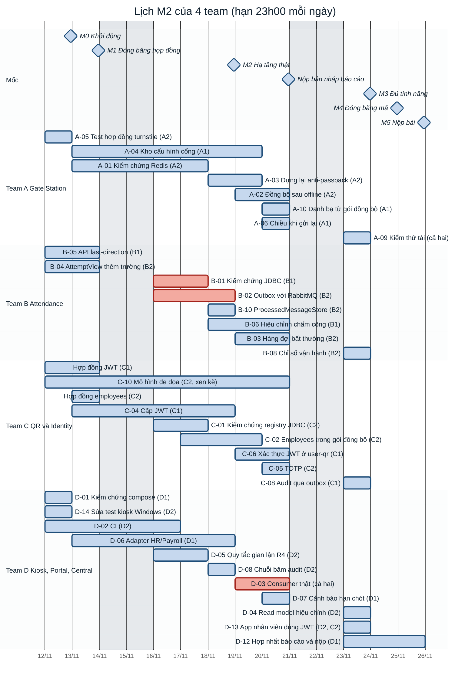
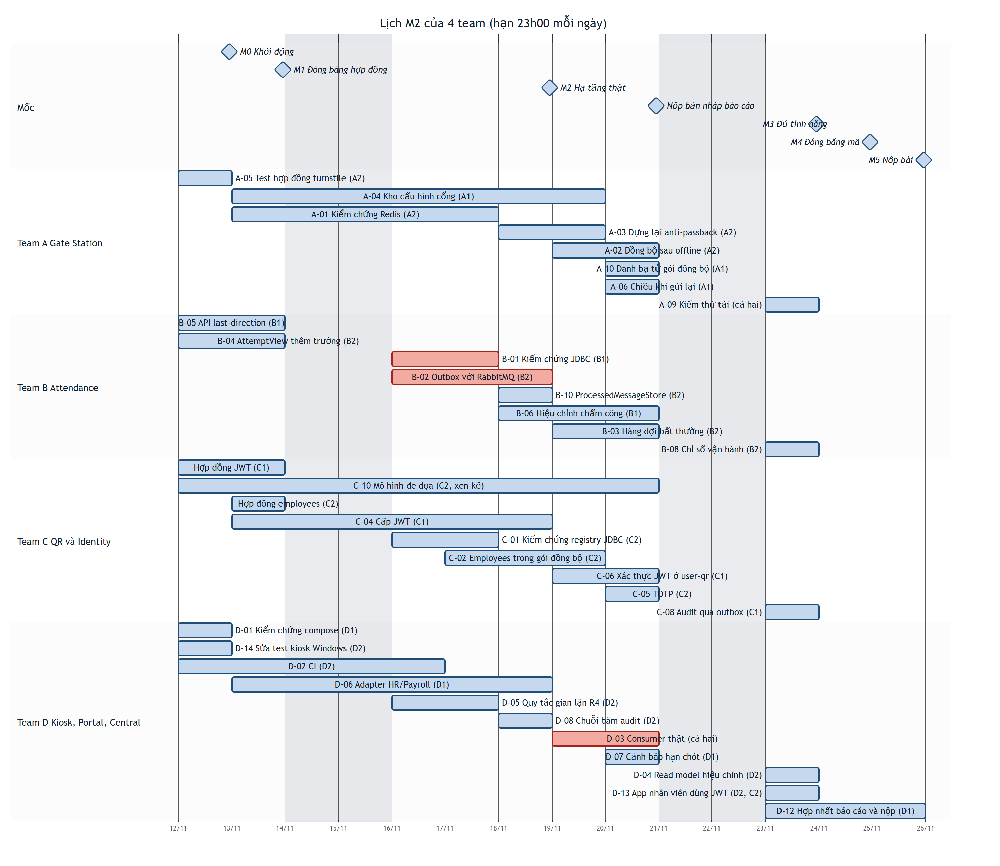

# Biểu đồ Gantt: 12/11 đến 25/11/2026

Biểu đồ này vẽ cùng một lịch với [01-ke-hoach.md](01-ke-hoach.md) mục 3. GitHub, GitLab và IntelliJ (có plugin Mermaid) hiển thị được trực tiếp. Nếu trình xem của bạn không vẽ Mermaid, xem ảnh [gantt.png](gantt.png) (tạo lại bằng `scripts/docs/render-gantt.mjs`). Bản tương tác, bấm vào từng story để xem chi tiết: mở [lich-ban-giao.html](lich-ban-giao.html) bằng trình duyệt.

**Mọi hạn là 23:00 của ngày cuối cùng trên thanh.** Thanh màu đỏ là đường găng: chậm ở đó thì chậm cả phần trung tâm. Hình thoi là mốc, đặt đúng 23:00 của ngày đó. Thứ Bảy và Chủ nhật không xếp việc.

## Đọc biểu đồ

| Ký hiệu | Nghĩa |
| --- | --- |
| Thanh | Một story; đầu trái là ngày bắt đầu, đầu phải là hết ngày cuối (hạn 23:00) |
| Thanh đỏ | Đường găng: B-01, B-02, D-03 |
| Hình thoi | Mốc của cả nhóm, lúc 23:00 |
| (A1), (B2), ... | Người làm trong team: 1 là lead, 2 là người còn lại |

Thứ tự phụ thuộc giữa các thanh (thanh nào phải xong trước thanh nào) và phương án khi bị trễ nằm ở [01-ke-hoach.md](01-ke-hoach.md) mục 4.

## Hạn theo ngày

| Hạn (23:00) | Phải hợp nhất xong |
| --- | --- |
| 12/11 | D-01, D-14, A-05; mọi người chạy được stack local |
| 13/11 | B-04, B-05; hợp đồng JWT; hợp đồng `employees`; lược đồ `AttendanceCorrected`; thiết kế A-04 trong OpenAPI |
| 16/11 | D-02 (CI) |
| 17/11 | A-01, B-01, C-01, D-05 |
| 18/11 | B-02, B-10, C-04, D-06, D-08 |
| 19/11 | A-03, A-04, C-02 |
| 20/11 | A-02, A-06, A-10, B-03, B-06, C-05, C-06, C-10, D-03, D-07; bản nháp báo cáo của 4 team |
| 23/11 | A-09, B-08, C-08, D-04, D-13; mọi story bắt buộc đã vào `main` |
| 24/11 | Đóng băng mã; tổng duyệt demo; báo cáo đủ nội dung |
| 25/11 | Nộp PDF báo cáo, URL GitHub, gắn tag |
