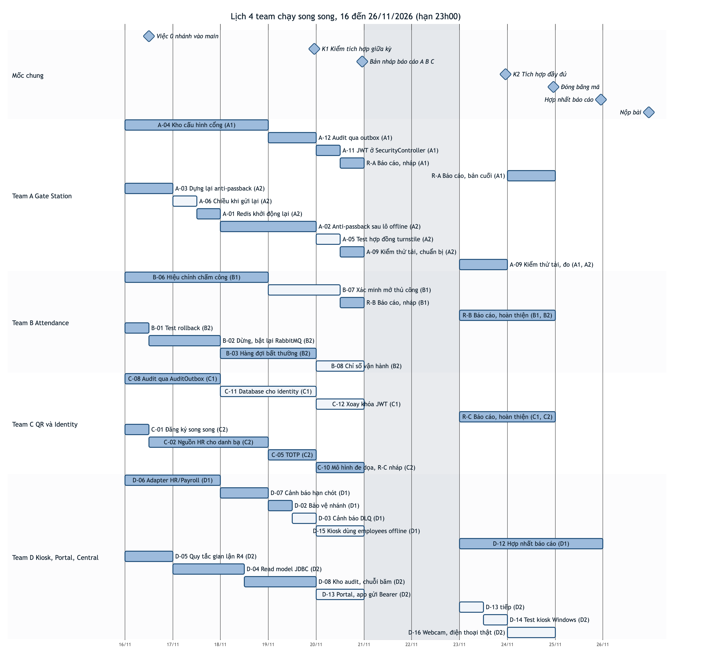
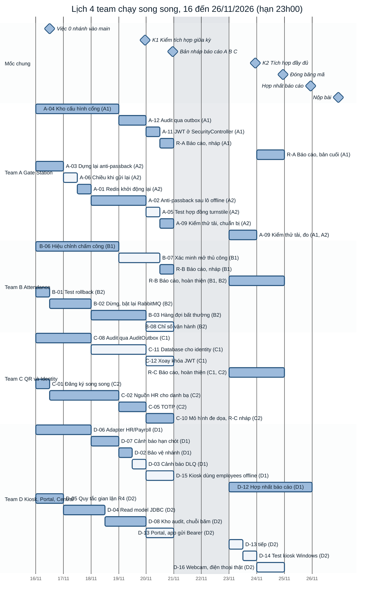

# Lịch và biểu đồ Gantt: 16/11 đến 26/11/2026

## Mở bản tương tác

### [▶ Mở lịch tương tác](https://htmlpreview.github.io/?https://github.com/lamelihuynh/tmc/blob/main/docs/handover/lich-ban-giao.html)

Trang này vẽ lịch của 8 người: bốn làn song song (Team A, B, C, D, mỗi team hai người) và một làn mốc chung. Bấm vào một story để xem mục tiêu, người làm, ngày, fixture để code theo và tiêu chí xong. Bên dưới lịch là bảng 7 lần kiểm tích hợp **tùy chọn** (I-1 đến I-7): không story nào chờ chúng.

**Mọi hạn là 23:00 của ngày cuối cùng trên thanh.** Thanh đậm là story bắt buộc; thanh nhạt là nên có hoặc làm nếu còn thời gian (cắt trước khi trễ, thứ tự ở [01-ke-hoach.md](01-ke-hoach.md) mục 6.3). Hình thoi là mốc chung, đặt đúng 23:00 của ngày đó. Thứ Bảy 21 và Chủ nhật 22/11 không xếp việc. Không có mũi tên phụ thuộc giữa các team: mỗi làn chạy độc lập.

### Vì sao không bấm thẳng vào tệp HTML

GitHub chỉ hiện mã nguồn khi bạn bấm vào một tệp `.html`, không chạy nó. Có ba cách xem bản tương tác:

| Cách | Đường dẫn | Ghi chú |
| --- | --- | --- |
| Xem trước qua htmlpreview | [đường dẫn ở trên](https://htmlpreview.github.io/?https://github.com/lamelihuynh/tmc/blob/main/docs/handover/lich-ban-giao.html) | Dùng được ngay. Dịch vụ bên thứ ba, đọc tệp công khai từ nhánh `main` |
| GitHub Pages | <https://lamelihuynh.github.io/tmc/> | Đường dẫn chính thức, chỉ có sau khi người quản trị repo bật Pages (cách bật ở đầu `.github/workflows/pages.yml`) |
| Mở từ máy | Mở `docs/handover/lich-ban-giao.html` bằng trình duyệt sau khi `git pull` | Không cần mạng, trừ phông chữ |

Muốn xem lịch của một nhánh khác, thay `main` trong đường dẫn htmlpreview bằng tên nhánh.

## Mốc chung

| Ngày (23:00) | Mốc |
| --- | --- |
| 16/11 (sáng) | Việc 0: nhánh `chore/x/decouple-teams` vào `main` |
| 19/11 | K1 Kiểm tích hợp giữa kỳ: I-1, I-2, I-3 (tùy chọn) |
| 20/11 | Bản nháp báo cáo của Team A, B, C |
| 23/11 | K2 Tích hợp đầy đủ: mọi story bắt buộc đã vào `main`; I-4 đến I-7 (tùy chọn) |
| 24/11 | Đóng băng mã; tổng duyệt demo lần 1; bản cuối phần báo cáo của từng team |
| 25/11 | Hợp nhất báo cáo (D-12), xuất PDF; tổng duyệt lần 2; dự phòng |
| 26/11 | Nộp bài |

## Hạn theo ngày

| Hạn (23:00) | Phải hợp nhất xong |
| --- | --- |
| 16/11 | Việc 0, A-03, B-01 (còn lại), C-01 (còn lại), D-05 |
| 17/11 | A-06, A-01 (còn lại), B-02 (còn lại), C-08, D-06 |
| 18/11 | A-04, B-06, C-02, D-04, D-07 |
| 19/11 | A-02, A-12, B-03, C-05, C-11, D-02 (còn lại), D-03 (còn lại), D-08 |
| 20/11 | A-05, A-11, B-07, B-08, C-10, C-12, D-15; nháp R-A, R-B, R-C |
| 23/11 | A-09, D-13, D-14; mọi story bắt buộc đã vào `main` |
| 24/11 | Đóng băng mã; D-16 (trong tổng duyệt); bản cuối R-A, R-B, R-C |
| 25/11 | D-12: PDF báo cáo |
| 26/11 | Nộp |

## Nguồn của ảnh Gantt

Ảnh `gantt.png` được vẽ từ khối Mermaid dưới đây bằng `scripts/docs/render-gantt.mjs` (`cd scripts/docs && npm ci && node render-gantt.mjs`; cần Chrome và mạng để tải Mermaid). Khi đổi lịch, sửa cả bốn nơi cho khớp: khối này, dữ liệu trong `lich-ban-giao.html`, bảng ở [01-ke-hoach.md](01-ke-hoach.md) mục 3, và bảng việc trong tài liệu của team; rồi chạy lại script.

Mã Mermaid (GitHub cũng vẽ được khối này)

