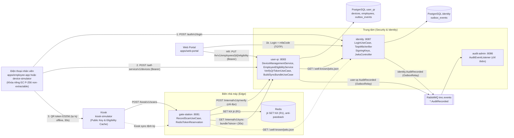
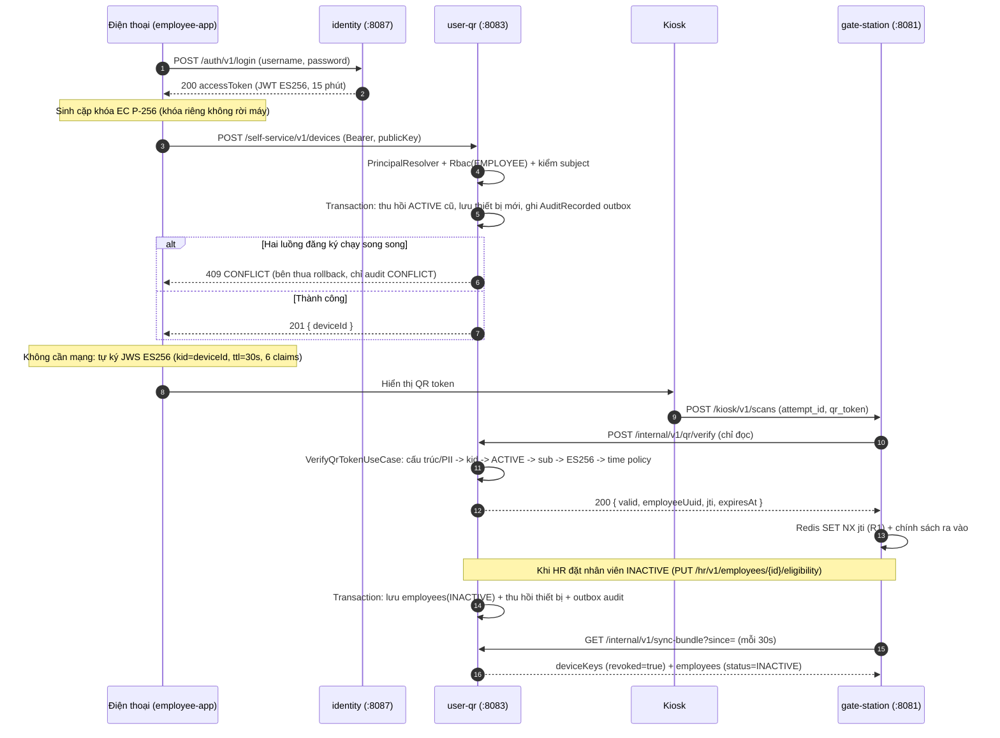
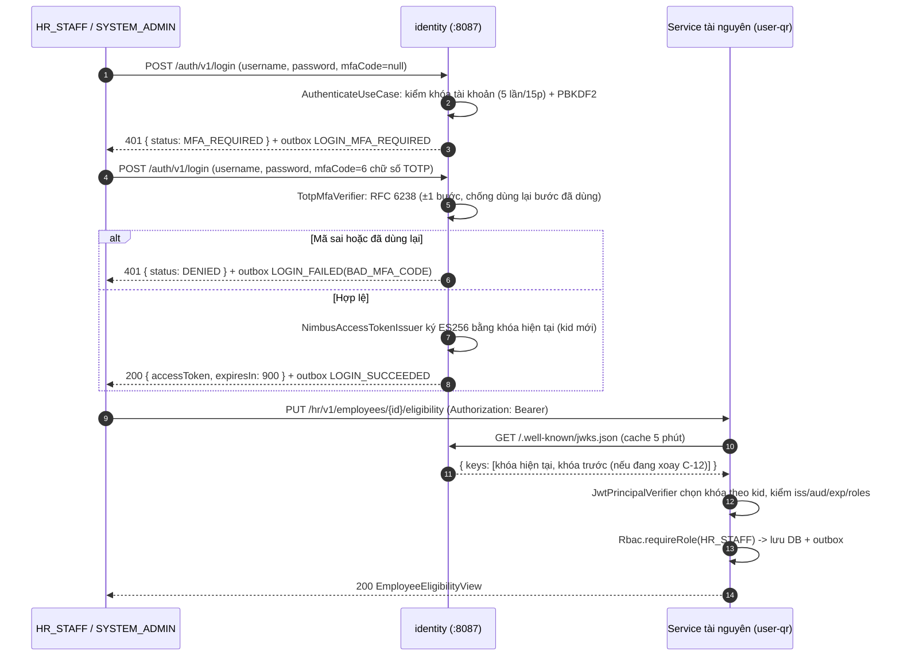

# Cập nhật Các góc nhìn Kiến trúc (Task 1.2)

> Phần này trả lời yêu cầu **Task 1.2** của đề bài M2: cập nhật Module View, Component & Connector View và Allocation/Deployment View phản ánh thay đổi từ ADR-11, ADR-12 và ADR-13. Hiện tại tệp chứa đầy đủ **phần sơ đồ bảo mật và danh tính của Team C** (R-C); các sơ đồ của Team A (luồng quét QR 15.2), Team B (outbox) và Team D (HR) sẽ được hợp nhất tại D-12.

---

## 1. Phần Team C: Sơ đồ Kiến trúc Bảo mật, Định danh & QR động

### 1.1. Component & Connector View — Luồng Bảo mật & Định danh (bổ sung cho mục 12.4 M1)

*Hình 12.4.2 Component và Connector của luồng Bảo mật, Định danh và Xác thực QR động (Team C)*

---

### 1.2. Sequence Diagram — Đăng ký thiết bị, Tự ký QR offline, Xác thực và Đồng bộ thu hồi (bổ sung cho mục 13.1 M1)

*Hình 13.1.2 Sequence diagram luồng đăng ký thiết bị, ký QR động và đồng bộ thu hồi (Team C)*

---

### 1.3. Sequence Diagram — Đăng nhập nhân sự có MFA TOTP, Kiểm tra JWT qua JWKS và Xoay khóa (C-05, C-12)

*Hình 13.1.3 Sequence diagram luồng MFA TOTP, xác thực Bearer JWKS và xoay khóa ký (Team C)*

---

### 1.4. Cập nhật Module View & Deployment View (Phần Team C)

| Góc nhìn | Thay đổi chi tiết trong mã hiện tại |
| --- | --- |
| **Module View** | - **`services/user-qr`** (`vn.tmc.userqr`): `domain` (`Device`, `DeviceStatus`, `QrClaims`, `TokenVerificationPolicy`); `application.port.in` (`IDeviceManagement`, `IEmployeeEligibility`, `IQRValidation`, `ISyncBundle`); `application.port.out` (`IDeviceKeyRegistry`, `IEmployeeDirectory`, `ITokenCodec`, `IAuditLog`, `ITransactionRunner`, `ActiveDeviceConflictException`); `adapter.out.persistence` (`JdbcDeviceKeyRegistry`, `JdbcEmployeeDirectory`, `SpringTransactionRunner`); `adapter.out.messaging` (`OutboxAuditLog`). - **`services/identity`** (`vn.tmc.identity`): `domain` (`Account`); `application.usecase` (`AuthenticateUseCase`, `LoginUseCase`); `adapter.out.crypto` (`NimbusAccessTokenIssuer`, `SigningKeys`, `TotpMfaVerifier`); `adapter.in.rest` (`AuthController`, `JwksController`); `adapter.out.messaging` (`OutboxAuditLog`). - **`platform/security`**: thư viện dùng chung (`PrincipalResolver`, `JwtPrincipalVerifier`, `AccessTokenSigner`, `AccessTokenContract`, `Rbac`, `Role`, `DataScope`), có `ArchitectureTest` ở mọi service kiểm tra không có phụ thuộc ngược hay import chéo giữa các service. |
| **Deployment View (C-11, C-02, ADR-12)** | - **Điện thoại / Trình duyệt:** giữ khóa riêng EC P-256 không thể xuất (`IndexedDB` trên web thử nghiệm; keystore/enclave trên app gốc). - **PostgreSQL Central (`:5433`):** database `user_qr` (`devices`, `outbox_events`, `employees` qua Flyway `V1`–`V3`) và database `identity` (`outbox_events` qua Flyway `V1`, profile mặc định C-11). - **Edge Node / Kiosk:** giữ bản sao khóa công khai thiết bị và danh bạ đủ điều kiện kéo từ `/internal/v1/sync-bundle`; `user-qr` hiện triển khai endpoint `/internal/v1/qr/verify` tại cùng service `user-qr` theo mô hình logic Edge (`implementation-notes.md` mục 1 điểm 6). |

---

## 2. Phần Team A, B, D *(chờ ghép khi hợp nhất D-12)*

- **Team A:** Sơ đồ luồng quét QR và triển khai tại biên (`15.2`, A-04 `gate_store`).
- **Team B:** Sơ đồ outbox, phục hồi `AccessAttempt` và đối soát `GATE_UNKNOWN`.
- **Team D:** Sơ đồ tích hợp HR/Payroll và đối soát (`D-06`, `D-04`, `D-08`).
