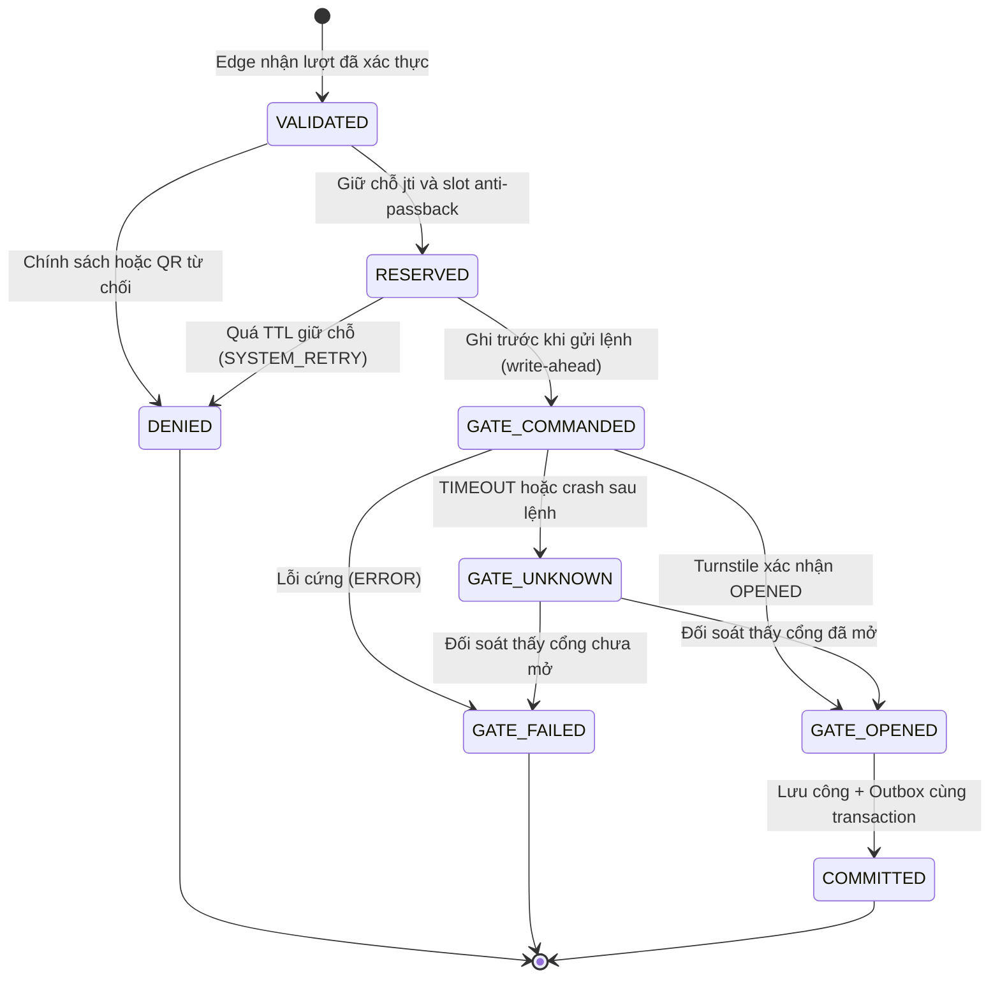
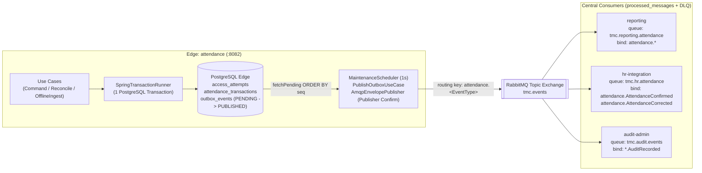

# Cập nhật các góc nhìn kiến trúc — Views Update (Task 1.2)

Phần này trả lời yêu cầu **Task 1.2** về việc cập nhật Component View, Sequence View và Deployment View cho khớp với mã nguồn hiện tại của Milestone 2.

> [!NOTE]
> Tệp này gồm phần **máy trạng thái lượt quét** và **luồng Outbox / Exchange `tmc.events` (ADR-15)** do **Team B** phụ trách (khớp mã nguồn `services/attendance` và `platform/messaging`). Các phần của Team A (quét QR, deployment 15.2), Team C (bảo mật), Team D (HR) giữ chỗ để hợp nhất ở D-12.

---

## 1. Sơ đồ máy trạng thái của một lượt quét — `AccessAttempt` (Team B)

Nguồn sự thật trong mã là enum `AttemptStatus` và aggregate `AccessAttempt` (`services/attendance/src/main/java/vn/tmc/attendance/domain/`). Khác với bản nháp đầu của ADR-11:
- `RECEIVED` chỉ tồn tại trong SQLite Journal tại kiosk.
- `PUBLISHED` là `publish_status` của bảng `outbox_events`, **không** nằm trong `AttemptStatus`.
- `GATE_FAILED` là trạng thái kết thúc (không đi qua `COMMITTED`).

*Hình 12.7.1 — Máy trạng thái giao dịch tại cổng (`AccessAttempt`), khớp `docs/architecture/state-machine.md`.*

### Bảng sự kiện phát ra theo bước chuyển trạng thái

| Chuyển trạng thái | Sự kiện vào `outbox_events` | Ghi chú hợp đồng (`attendance-events.asyncapi.yaml`) |
| --- | --- | --- |
| Tạo `RESERVED` | `AccessAttemptRecorded` | Chưa đủ điều kiện gửi HR |
| `DENIED` do chính sách, QR hoặc quá TTL giữ chỗ (`SYSTEM_RETRY`) | `AuditRecorded` | `action = "ACCESS_DENIED"` hoặc `"RESERVATION_RELEASED"` |
| `GATE_COMMANDED` | Không phát sự kiện | Chỉ là điểm ghi trước (write-ahead) |
| `GATE_OPENED`, `GATE_FAILED`, `GATE_UNKNOWN` | `GateResultRecorded` | Giữ nguyên `gateResult` (`OPENED`, `ERROR`, `UNKNOWN`) |
| `COMMITTED` (nguồn `ONLINE`/`OFFLINE`, không bất thường) | `AttendanceConfirmed` | Dữ liệu đủ điều kiện đồng bộ HR |
| `COMMITTED` với nguồn `MANUAL` | `AuditRecorded` | `action = "MANUAL_OPEN_PENDING_VERIFICATION"`, không tự tạo `AttendanceTransaction` |
| Nhập offline có bất thường | `AuditRecorded` | `action = "TOKEN_REUSED_OFFLINE"` hoặc `"ANTI_PASSBACK_OFFLINE"`, không tính công |

---

## 2. Kiến trúc Outbox và Exchange dùng chung `tmc.events` (Team B, ADR-15)

Để bảo đảm phát sự kiện ra trung tâm không mất và không trùng khi mạng WAN hoặc RabbitMQ gián đoạn:
- **Ghi nguyên tử trong `attendance`:** Các use case (`AttendanceCommandService`, `GateResultApplier`, `IngestOfflineBatchUseCase`, `RecoverStaleAttemptsUseCase`, `ReconcileUnknownUseCase`) ghi thay đổi của `access_attempts` / `attendance_transactions` và chèn bản ghi JSONB vào bảng `outbox_events` (`publish_status = 'PENDING'`, thứ tự `seq BIGSERIAL`) trong **cùng một transaction** qua `SpringTransactionRunner`.
- **Phát với xác nhận từ broker:** `MaintenanceScheduler` kích hoạt `PublishOutboxUseCase.run()` mỗi 1 giây, lấy các dòng `PENDING` theo thứ tự `seq` và gọi `AmqpEnvelopePublisher` đẩy lên một **Topic Exchange bền duy nhất là `tmc.events`** (`TmcExchange.NAME`) với khóa định tuyến **`attendance.<EventType>`** (`TmcExchange.ATTENDANCE`), chờ `ConfirmType.CORRELATED` (trường `source` bên trong envelope là `"attendance-edge"` theo `AttendanceEventFactory`). Chỉ khi broker xác nhận ACK mới cập nhật `publish_status = 'PUBLISHED'`; khi gặp lỗi, tăng `failure_count` và dừng ngay vòng lặp để bảo toàn thứ tự.
- **Khử trùng phía tiêu thụ:** Mỗi service phía Central có hàng đợi bền riêng (`tmc.reporting.attendance`, `tmc.hr.attendance`, `tmc.audit.events`) và Dead-Letter Queue (`<queue>.dlq`, thử lại 3 lần), dùng `IdempotentConsumer` và `JdbcProcessedMessageStore` (bảng `processed_messages` trong cùng transaction với handler). Hợp đồng `attendance.AttendanceCorrected` đã chốt trong `attendance-events.asyncapi.yaml` và `AttendanceEventFactory.attendanceCorrected(...)` (phần use case/endpoint thuộc B-06).

*Hình 12.7.2 — Luồng Transactional Outbox và định tuyến sự kiện trên exchange `tmc.events` (ADR-15).*

---

## 3. Phần chờ các team khác (D-12 hợp nhất)

- **Luồng quét QR & Deployment 15.2:** *[Chờ Team A]*
- **Bảo mật, thiết bị & Identity:** *[Chờ Team C]*
- **HR Integration & Consumer Central:** *[Chờ Team D]*

