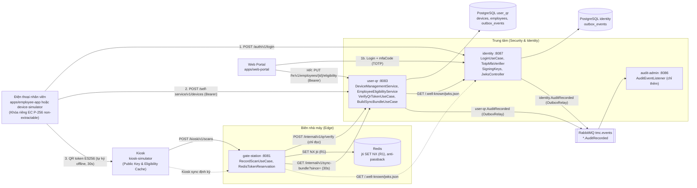
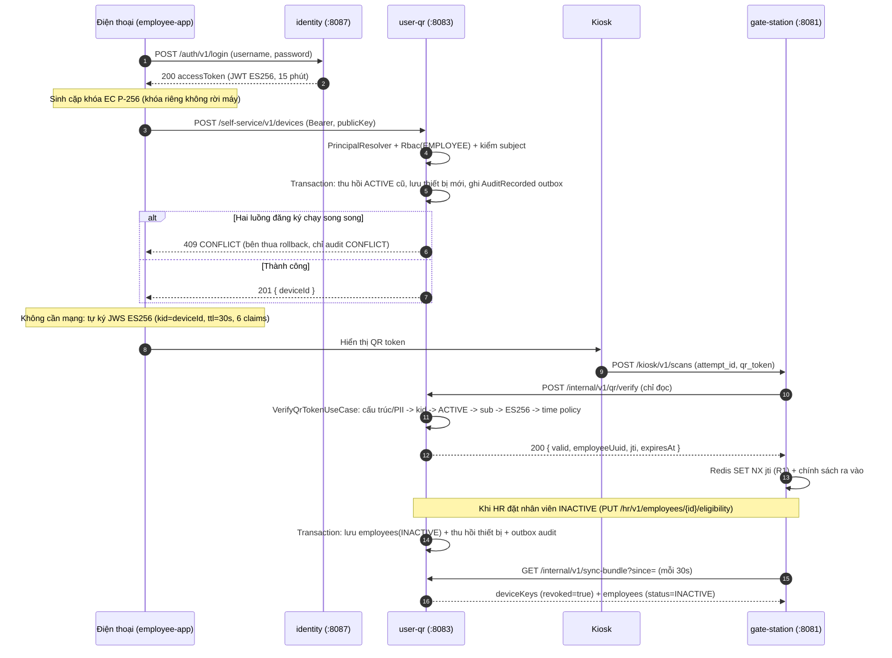
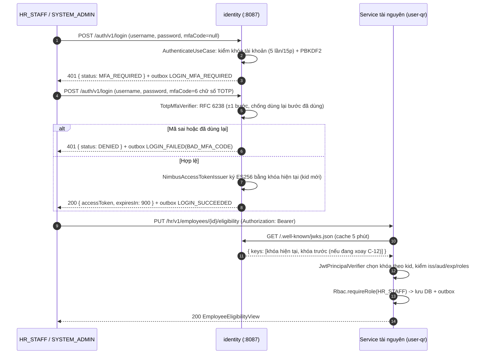
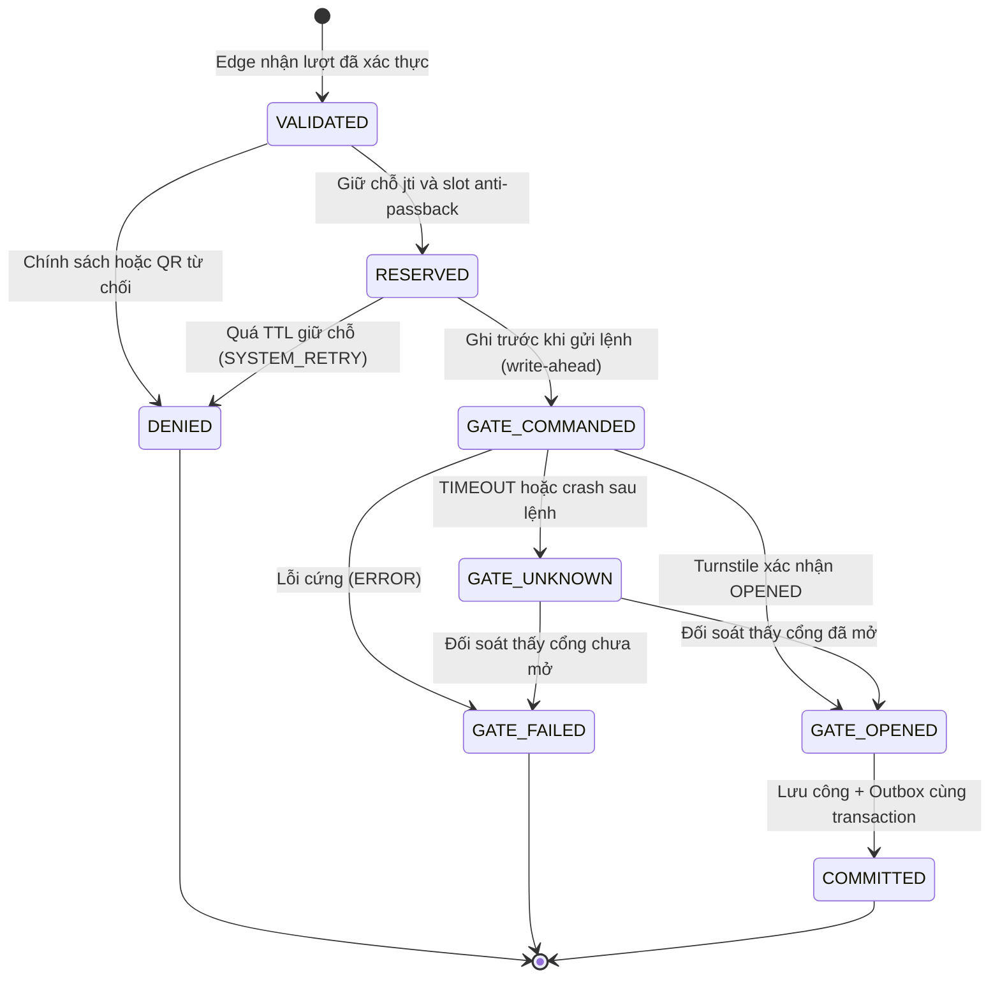
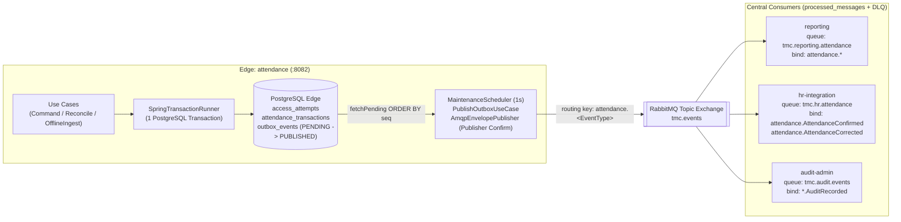
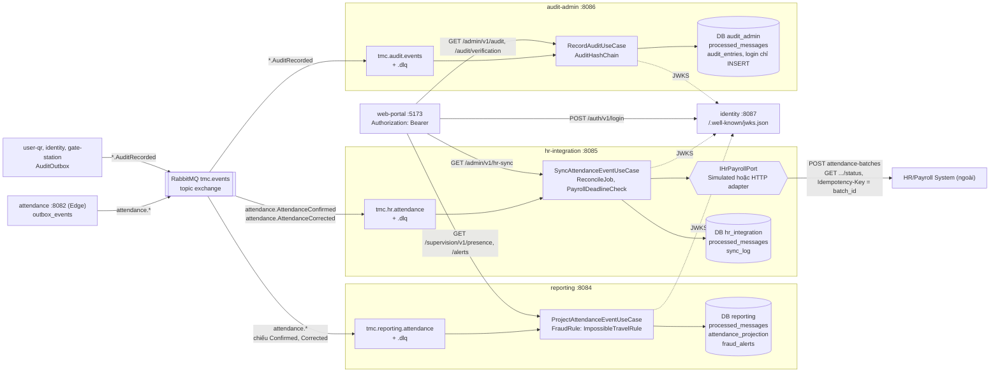

# Cập nhật Các góc nhìn Kiến trúc (Task 1.2)

> Phần này trả lời yêu cầu **Task 1.2** của đề bài M2: cập nhật Module View, Component & Connector View và Allocation/Deployment View phản ánh thay đổi từ ADR-11, ADR-12 và ADR-13. Tệp gồm **sơ đồ bảo mật và danh tính của Team C** (R-C) và **máy trạng thái lượt quét cùng luồng Outbox / Exchange `tmc.events` (ADR-15) của Team B**, và **các consumer trung tâm cùng tích hợp HR/Payroll của Team D** (mục 4); sơ đồ của Team A (luồng quét QR 15.2) sẽ được hợp nhất tại D-12.

---

## 1. Phần Team C: Sơ đồ Kiến trúc Bảo mật, Định danh & QR động

### 1.1. Component & Connector View — Luồng Bảo mật & Định danh (bổ sung cho mục 12.4 M1)

*Hình 12.4.2 Component và Connector của luồng Bảo mật, Định danh và Xác thực QR động (Team C)*

---

### 1.2. Sequence Diagram — Đăng ký thiết bị, Tự ký QR offline, Xác thực và Đồng bộ thu hồi (bổ sung cho mục 13.1 M1)

*Hình 13.1.2 Sequence diagram luồng đăng ký thiết bị, ký QR động và đồng bộ thu hồi (Team C)*

---

### 1.3. Sequence Diagram — Đăng nhập nhân sự có MFA TOTP, Kiểm tra JWT qua JWKS và Xoay khóa (C-05, C-12)

*Hình 13.1.3 Sequence diagram luồng MFA TOTP, xác thực Bearer JWKS và xoay khóa ký (Team C)*

---

### 1.4. Cập nhật Module View & Deployment View (Phần Team C)

| Góc nhìn | Thay đổi chi tiết trong mã hiện tại |
| --- | --- |
| **Module View** | - **`services/user-qr`** (`vn.tmc.userqr`): `domain` (`Device`, `DeviceStatus`, `QrClaims`, `TokenVerificationPolicy`); `application.port.in` (`IDeviceManagement`, `IEmployeeEligibility`, `IQRValidation`, `ISyncBundle`); `application.port.out` (`IDeviceKeyRegistry`, `IEmployeeDirectory`, `ITokenCodec`, `IAuditLog`, `ITransactionRunner`, `ActiveDeviceConflictException`); `adapter.out.persistence` (`JdbcDeviceKeyRegistry`, `JdbcEmployeeDirectory`, `SpringTransactionRunner`); `adapter.out.messaging` (`OutboxAuditLog`). - **`services/identity`** (`vn.tmc.identity`): `domain` (`Account`); `application.usecase` (`AuthenticateUseCase`, `LoginUseCase`); `adapter.out.crypto` (`NimbusAccessTokenIssuer`, `SigningKeys`, `TotpMfaVerifier`); `adapter.in.rest` (`AuthController`, `JwksController`); `adapter.out.messaging` (`OutboxAuditLog`). - **`platform/security`**: thư viện dùng chung (`PrincipalResolver`, `JwtPrincipalVerifier`, `AccessTokenSigner`, `AccessTokenContract`, `Rbac`, `Role`, `DataScope`), có `ArchitectureTest` ở mọi service kiểm tra không có phụ thuộc ngược hay import chéo giữa các service. |
| **Deployment View (C-11, C-02, ADR-12)** | - **Điện thoại / Trình duyệt:** giữ khóa riêng EC P-256 không thể xuất (`IndexedDB` trên web thử nghiệm; keystore/enclave trên app gốc). - **PostgreSQL Central (`:5433`):** database `user_qr` (`devices`, `outbox_events`, `employees` qua Flyway `V1`–`V3`) và database `identity` (`outbox_events` qua Flyway `V1`, profile mặc định C-11). - **Edge Node / Kiosk:** giữ bản sao khóa công khai thiết bị và danh bạ đủ điều kiện kéo từ `/internal/v1/sync-bundle`; `user-qr` hiện triển khai endpoint `/internal/v1/qr/verify` tại cùng service `user-qr` theo mô hình logic Edge (`implementation-notes.md` mục 1 điểm 6). |

---

## 2. Sơ đồ máy trạng thái của một lượt quét — `AccessAttempt` (Team B)

Nguồn sự thật trong mã là enum `AttemptStatus` và aggregate `AccessAttempt` (`services/attendance/src/main/java/vn/tmc/attendance/domain/`). Khác với bản nháp đầu của ADR-11:
- `RECEIVED` chỉ tồn tại trong SQLite Journal tại kiosk.
- `PUBLISHED` là `publish_status` của bảng `outbox_events`, **không** nằm trong `AttemptStatus`.
- `GATE_FAILED` là trạng thái kết thúc (không đi qua `COMMITTED`).

*Hình 12.7.1 — Máy trạng thái giao dịch tại cổng (`AccessAttempt`), khớp `docs/architecture/state-machine.md`.*

### Bảng sự kiện phát ra theo bước chuyển trạng thái

| Chuyển trạng thái | Sự kiện vào `outbox_events` | Ghi chú hợp đồng (`attendance-events.asyncapi.yaml`) |
| --- | --- | --- |
| Tạo `RESERVED` | `AccessAttemptRecorded` | Chưa đủ điều kiện gửi HR |
| `DENIED` do chính sách, QR hoặc quá TTL giữ chỗ (`SYSTEM_RETRY`) | `AuditRecorded` | `action = "ACCESS_DENIED"` hoặc `"RESERVATION_RELEASED"` |
| `GATE_COMMANDED` | Không phát sự kiện | Chỉ là điểm ghi trước (write-ahead) |
| `GATE_OPENED`, `GATE_FAILED`, `GATE_UNKNOWN` | `GateResultRecorded` | Giữ nguyên `gateResult` (`OPENED`, `ERROR`, `UNKNOWN`) |
| `COMMITTED` (nguồn `ONLINE`/`OFFLINE`, không bất thường) | `AttendanceConfirmed` | Dữ liệu đủ điều kiện đồng bộ HR |
| `COMMITTED` với nguồn `MANUAL` | `AuditRecorded` | `action = "MANUAL_OPEN_PENDING_VERIFICATION"`, không tự tạo `AttendanceTransaction` |
| Nhập offline có bất thường | `AuditRecorded` | `action = "TOKEN_REUSED_OFFLINE"` hoặc `"ANTI_PASSBACK_OFFLINE"`, không tính công |

---

## 3. Kiến trúc Outbox và Exchange dùng chung `tmc.events` (Team B, ADR-15)

Để bảo đảm phát sự kiện ra trung tâm không mất và không trùng khi mạng WAN hoặc RabbitMQ gián đoạn:
- **Ghi nguyên tử trong `attendance`:** Các use case (`AttendanceCommandService`, `GateResultApplier`, `IngestOfflineBatchUseCase`, `RecoverStaleAttemptsUseCase`, `ReconcileUnknownUseCase`) ghi thay đổi của `access_attempts` / `attendance_transactions` và chèn bản ghi JSONB vào bảng `outbox_events` (`publish_status = 'PENDING'`, thứ tự `seq BIGSERIAL`) trong **cùng một transaction** qua `SpringTransactionRunner`.
- **Phát với xác nhận từ broker:** `MaintenanceScheduler` kích hoạt `PublishOutboxUseCase.run()` mỗi 1 giây, lấy các dòng `PENDING` theo thứ tự `seq` và gọi `AmqpEnvelopePublisher` đẩy lên một **Topic Exchange bền duy nhất là `tmc.events`** (`TmcExchange.NAME`) với khóa định tuyến **`attendance.<EventType>`** (`TmcExchange.ATTENDANCE`), chờ `ConfirmType.CORRELATED` (trường `source` bên trong envelope là `"attendance-edge"` theo `AttendanceEventFactory`). Chỉ khi broker xác nhận ACK mới cập nhật `publish_status = 'PUBLISHED'`; khi gặp lỗi, tăng `failure_count` và dừng ngay vòng lặp để bảo toàn thứ tự.
- **Khử trùng phía tiêu thụ:** Mỗi service phía Central có hàng đợi bền riêng (`tmc.reporting.attendance`, `tmc.hr.attendance`, `tmc.audit.events`) và Dead-Letter Queue (`<queue>.dlq`, thử lại 3 lần), dùng `IdempotentConsumer` và `JdbcProcessedMessageStore` (bảng `processed_messages` trong cùng transaction với handler). Hợp đồng `attendance.AttendanceCorrected` đã chốt trong `attendance-events.asyncapi.yaml` và `AttendanceEventFactory.attendanceCorrected(...)` (phần use case/endpoint thuộc B-06).

*Hình 12.7.2 — Luồng Transactional Outbox và định tuyến sự kiện trên exchange `tmc.events` (ADR-15).*

---

## 4. Consumer trung tâm và tích hợp HR/Payroll (Team D)

Mục này cập nhật mục 12.5 của M1 (Hình 12.5.1) theo mã hiện tại: ba consumer `reporting`, `hr-integration`, `audit-admin` mỗi service có hàng đợi, DLQ, database và bảng chống trùng riêng (ADR-10, ADR-15); `hr-integration` giữ nhật ký đồng bộ và tra cứu HR trước khi gửi lại (ADR-07, D-06); `audit-admin` giữ nhật ký chỉ thêm có chuỗi băm (ADR-16). Luồng chi tiết của HR và của chuỗi băm: [07-implementation.md](07-implementation.md), Hình 18.4.1 và 18.4.2.

### 4.1. Component & Connector View — Consumer trung tâm và tích hợp HR (bổ sung cho mục 12.5 M1)

*Hình 12.5.2 Component và connector của các consumer trung tâm và tích hợp HR/Payroll (Team D).*

| Connector | Ngữ nghĩa | Bằng chứng |
| --- | --- | --- |
| `tmc.events` → hàng đợi riêng mỗi consumer | Giao ít nhất một lần; chống trùng bằng `processed_messages` trong cùng transaction với handler; lỗi lặp lại sau 3 lần vào `<hàng đợi>.dlq`, gauge `tmc.rabbitmq.dlq.depth` | `AttendanceEventListenerIT`, `HrAttendanceListenerIT`, `AuditEventListenerIT`, `PresencePersistenceIT.should_roll_back_the_projection_and_the_marker_when_the_handler_fails` |
| `hr-integration` → HR/Payroll | Lô một dòng; `Idempotency-Key = batch_id`; kết quả không rõ thì tra cứu trước, chỉ gửi lại khi HR trả 404; job đối soát định kỳ có backoff | `SyncAttendanceEventTest`, `HrRetryTest`, `HttpHrPayrollAdapterTest` |
| Portal → ba service | JWT của identity kiểm qua JWKS; thiếu hoặc sai token `401`, không đủ quyền `403` | `BearerTokenApiTest` (ba service), `apps/web-portal/src/lib/auth.test.ts` |

### 4.2. Module View & Deployment View (Phần Team D)

| Góc nhìn | Thay đổi chi tiết trong mã hiện tại |
| --- | --- |
| **Module View** | - **`services/reporting`** (`vn.tmc.reporting`): `domain` (`ScanRecord`, `Presence`, `FraudRule`, `ImpossibleTravelRule`, `FraudAlert`); `application.port.out` (`IPresenceRepository`, `IFraudAlertStore`); `adapter.out.inmem` (`InMemoryPresenceRepository`, `InMemoryFraudAlertStore`) và `adapter.out.persistence` (`JdbcPresenceRepository`, `JdbcFraudAlertStore`). - **`services/hr-integration`** (`vn.tmc.hrintegration`): `domain` (`SyncRecord`, `SyncStatus`, `PayrollLine`); `application.usecase` (`SyncAttendanceEventUseCase`, `PayrollDeadlineCheck`, `SyncMonitoringService`); `application.port.out` (`IHrPayrollPort`, `ISyncLogRepository`); adapter `SimulatedHrPayrollAdapter`, `HttpHrPayrollAdapter`, `InMemorySyncLogRepository`, `JdbcSyncLogRepository`. - **`services/audit-admin`** (`vn.tmc.auditadmin`): `domain` (`AuditEntry`, `AuditHashChain`); `application.port.out.IAuditStore` (chỉ `append`, `search`, `count`, `verifyChain`); adapter `InMemoryAuditStore`, `JdbcAuditStore`. - Mỗi service có `adapter.in.messaging.DlqMonitor` và `ArchitectureTest` (`HexagonalRules`). |
| **Deployment View** | - **PostgreSQL Central (`:5433`):** database `reporting` (Flyway `V1__processed_messages`, `V2__presence`, `V3__fraud_alerts`), `hr_integration` (`V1`, `V2__sync_log`), `audit_admin` (`V1`, `V2__audit_entries`; Flyway chạy bằng chủ sở hữu `auditadmin`, service chạy bằng `auditadmin_app` chỉ `SELECT`, `INSERT`). - **RabbitMQ Central:** hàng đợi `tmc.reporting.attendance`, `tmc.hr.attendance`, `tmc.audit.events`, mỗi hàng đợi một DLQ. - **Cấu hình:** `tmc.hr.mode` = `simulated` (mặc định, không có HR thật) hoặc `http` (cần `tmc.hr.url`, `HR_PAYROLL_API_TOKEN`); profile `local`, `inmem` dùng adapter trong bộ nhớ, profile mặc định dùng PostgreSQL. |

---

## 5. Phần Team A *(chờ ghép khi hợp nhất D-12)*

- **Team A:** Sơ đồ luồng quét QR và triển khai tại biên (`15.2`, A-04 `gate_store`).
