# 18 Hiện thực module đã chọn, cách chạy và kết quả (Task 2)

> Phần này trả lời yêu cầu **Task 2** của đề bài M2: hiện thực một module của kiến trúc, nêu cách chạy và trình bày kết quả. Mã nguồn: **https://github.com/lamelihuynh/tmc**. Mọi khẳng định về hành vi dưới đây trỏ tới một lớp test hoặc một kịch bản demo; điều mã chưa làm nằm ở [08-limitations.md](08-limitations.md).

---

## 18.1 Module đã chọn: Attendance Event Recording tại biên

Nhóm chọn hiện thực **Attendance Event Recording tại biên nhà máy** (FR-17 đến FR-20, UC-07, UC-08), vì đây là luồng chịu cả hai vấn đề của mục "Issues Encountered": mất kết nối giữa chừng (ADR-11) và QR tĩnh bị lộ (ADR-12). Module gồm các thành phần tại biên và các consumer phía trung tâm nhận sự kiện của nó:

| Thành phần | Thư mục | Team | Vai trò trong module | Bằng chứng chính |
| --- | --- | --- | --- | --- |
| Kiosk (dòng lệnh) | `simulators/kiosk-simulator` | D | Ghi Kiosk Journal trước khi gọi mạng, gửi lại cùng `attempt_id`, tự xác thực khi offline, giao journal theo thứ tự | `KioskAppTest`, `QrTokenPolicyContractTest`, `make demo-offline` |
| Trang kiosk web, app nhân viên | `apps/employee-app` | D, C | App tự ký QR bằng khóa thiết bị; trang `/kiosk` quét bằng webcam | `token.test.ts`, `api.test.ts` |
| Gate Station | `services/gate-station` | A | Điều phối luồng quét (ADR-13): xác thực QR, giữ chỗ `jti`, anti-passback, gọi Turnstile | `RecordScanUseCaseTest`, `RedisAdaptersIT`, `make demo-online`, `make demo-timeout` |
| Attendance | `services/attendance` | B | Sổ lượt quét: máy trạng thái `AccessAttempt`, outbox, nhập lô offline, phục hồi, đối soát | `Adr11ResilienceTest`, `PersistenceAndBrokerIT`, `OutboxBrokerRestartIT` |
| User/QR | `services/user-qr` | C | Đăng ký thiết bị, xác thực QR theo khóa thiết bị (chỉ đọc), gói đồng bộ | `Adr12TokenVerificationTest`, `UserQrPersistenceIT` |
| Identity | `services/identity` | C | Đăng nhập, JWT `ES256`, JWKS, TOTP | `LoginApiTest`, `TotpLoginApiTest` |
| Consumer trung tâm | `services/reporting`, `services/hr-integration`, `services/audit-admin` | D | Hiện diện và cảnh báo gian lận (R4), đồng bộ HR/Payroll, nhật ký kiểm toán chỉ thêm | mục 18.4 |
| Turnstile, điện thoại giả lập | `simulators/turnstile-simulator`, `simulators/device-simulator` | A, C | Cổng xoay có chèn lỗi; điện thoại sinh khóa và ký token | dùng trong 3 demo |

Chi tiết cách từng điểm đứt P1 đến P7 được xử lý và chống dùng lại R1 đến R4 nằm ở [01-issues-connectivity.md](01-issues-connectivity.md) và [02-issues-static-qr.md](02-issues-static-qr.md); phần này không lặp lại.

---

## 18.2 Cách chạy

Yêu cầu: JDK 21; Node.js cho hai ứng dụng web; Docker chỉ cần cho test tích hợp và hạ tầng đầy đủ. Hướng dẫn đầy đủ: [`README.md`](../../README.md) mục "Chạy trong 4 bước" và [`docs/handover/02-chay-local.md`](../handover/02-chay-local.md).

| Bước | Lệnh | Ghi chú |
| --- | --- | --- |
| 1. Build và test đơn vị | `./gradlew build` (hoặc `make build`) | Không cần Docker |
| 2. Dựng stack local | Windows: `pwsh scripts/dev/local-stack.ps1 start`; macOS, Linux: `make local-up` (gọi `scripts/dev/local-stack.sh`) | 5 tiến trình profile `local`: turnstile-simulator `:8090`, user-qr `:8083`, attendance `:8082`, gate-station `:8081`, identity `:8087`; dữ liệu trong bộ nhớ, HTTP thật giữa các service |
| 3. App nhân viên và trang kiosk | `cd apps/employee-app && npm install && npm run dev`, mở `http://localhost:5174` (kiosk: `/kiosk`) | Tài khoản mẫu `nv001` đến `nv005` |
| 4. Ba kịch bản demo | `bash scripts/demo/online.sh`, `bash scripts/demo/offline.sh`, `bash scripts/demo/timeout.sh` (tương đương `make demo-online`, `make demo-offline`, `make demo-timeout`) | Khởi động lại stack giữa hai demo (`make local-restart` hoặc `local-stack.ps1 restart`) vì trạng thái anti-passback nằm trong bộ nhớ |

Ba service trung tâm **không** nằm trong stack local 5 tiến trình. Chạy riêng bằng `./gradlew :services:<tên>:bootRun` với `SPRING_PROFILES_ACTIVE=inmem` (không cần database), hoặc ở profile mặc định trên hạ tầng `make up` (PostgreSQL edge `:5432`, central `:5433`, Redis, RabbitMQ) theo [`02-chay-local.md`](../handover/02-chay-local.md) mục 9. Web portal: `cd apps/web-portal && npm install && npm run dev` (cổng 5173).

---

## 18.3 Kiểm thử và kết quả

### 18.3.1 Lệnh kiểm thử

| Muốn kiểm | Lệnh | Cần Docker |
| --- | --- | --- |
| Build, test đơn vị và luật kiến trúc của mọi module | `./gradlew build` | Không |
| Test tích hợp (Testcontainers: PostgreSQL, RabbitMQ, Redis thật) | `./gradlew integrationTest` (hoặc `make integration`) | Có |
| App nhân viên | `cd apps/employee-app && npm test` (kèm `npm run lint && npm run build`) | Không |
| Web portal | `cd apps/web-portal && npm test` (kèm `npm run lint && npm run build`) | Không |
| Ba kịch bản demo | `make demo-online`, `make demo-offline`, `make demo-timeout` trên stack local | Không |
| Đo tải Gate Station (A-09) | `.\scripts\perf\gate-station-a09.ps1` | Không |

Báo cáo HTML của Gradle: `<module>/build/reports/tests/test/index.html`.

### 18.3.2 Kết quả

| Hạng mục | Kết quả | Điều kiện |
| --- | --- | --- |
| Test đơn vị, kiến trúc và tích hợp | Xanh trên nhánh hợp nhất của Team D, gồm các lớp test của ba service trung tâm và kiosk liệt kê ở mục 18.4 | Số test chính xác lấy từ báo cáo Gradle ở commit nộp; mốc 16/11 là 209 test đơn vị (10 bỏ qua) và 27 test tích hợp ([`_decoupling-changelog.md`](../handover/_decoupling-changelog.md)) |
| `kiosk-simulator` trên Windows (D-14) | Cả 29 test của `kiosk-simulator` (`KioskAppTest`, `QrTokenPolicyContractTest`) xanh | `.\gradlew.bat :simulators:kiosk-simulator:test` |
| Hai ứng dụng web | `npm test` xanh, gồm `apps/web-portal/src/lib/auth.test.ts` và `apps/employee-app/src/lib/api.test.ts` (Bearer, 401 về đăng nhập) | |
| 3 kịch bản demo | Mỗi script in `OK` cho từng khẳng định và kết thúc bằng `... demo passed` ([`demo-scenarios.md`](../runbook/demo-scenarios.md)) | Stack **local** (profile `local`, dữ liệu trong bộ nhớ). Chưa chạy trên stack Docker đầy đủ (xem 08) |
| Đo tải A-09 | 800/800 lượt `ALLOWED`, p95 36,82 ms, p99 41,60 ms ([`A-09-load-test.md`](A-09-load-test.md)) | Windows, stack local không Docker, phát tải tuần tự 0,45 lượt/giây; **không** đại diện cho tải đồng thời hay stack Docker |

Đầu ra mẫu của `make demo-online` (trích từ `README.md`):

```text
== 3. Scan a fresh 30 s token at the entry gate
   ALLOWED attempt=01a1c834-d81f-7eeb-8964-f97c8dcf0b3d reason=null direction=ENTRY mode=ONLINE
   OK   got "ALLOWED"
== 4. The same QR used again (a screenshot) is refused, the gate stays closed
   OK   got "QR_ALREADY_USED"
== 5. A token that looks like a static QR (24 h) is refused
   OK   got "MALFORMED_TOKEN"
== 7. Two entries in a row are refused by anti-passback
   OK   got "ANTI_PASSBACK_VIOLATION"
== online demo passed
```

### 18.3.3 Ảnh chụp ứng dụng

Ảnh 01 đến 08 được chụp tự động từ ứng dụng thật chạy với stack local (`scripts/docs/capture-screenshots.mjs`). Theo `README.md`, ảnh 09 đến 11 chụp bằng `scripts/docs/capture-portal.mjs` khi các service chạy trên PostgreSQL, Redis và RabbitMQ thật, vì trang quản đốc và HR chỉ có dữ liệu khi sự kiện đi qua RabbitMQ.

| Đăng nhập | Đăng ký thiết bị | Mã QR đổi mỗi 20 giây | Cổng mở |
| :---: | :---: | :---: | :---: |
| 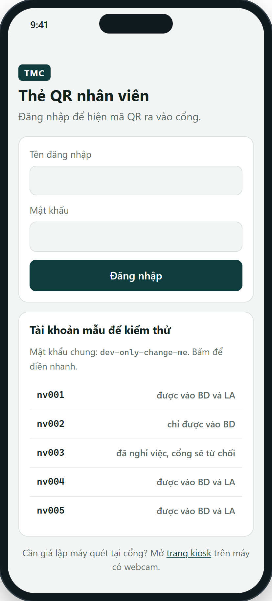 | 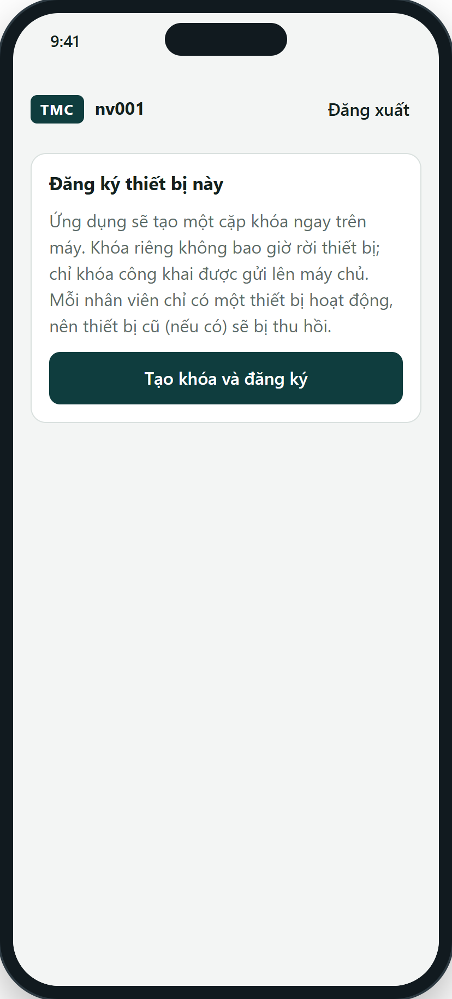 | 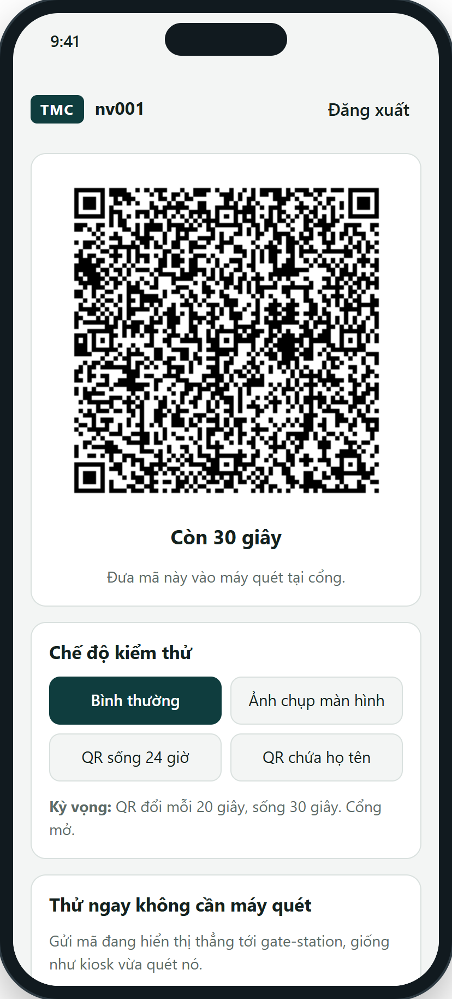 | 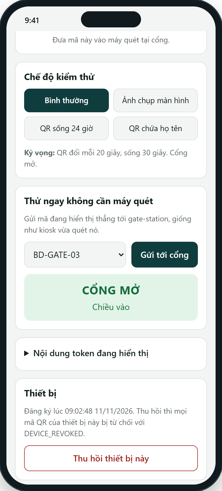 |
| *Hình 18.3.1* | *Hình 18.3.2* Khóa riêng tạo trên máy | *Hình 18.3.3* Mỗi mã sống 30 giây | *Hình 18.3.4* `ALLOWED`, chiều vào |

| Dùng lại mã (ảnh chụp màn hình) | Mã chứa họ tên | Nội dung token |
| :---: | :---: | :---: |
| 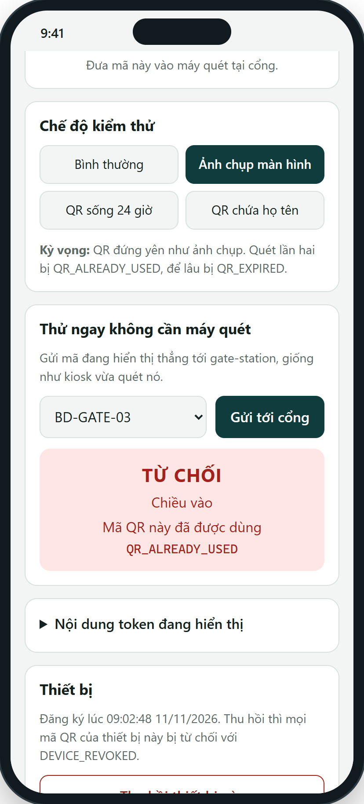 | 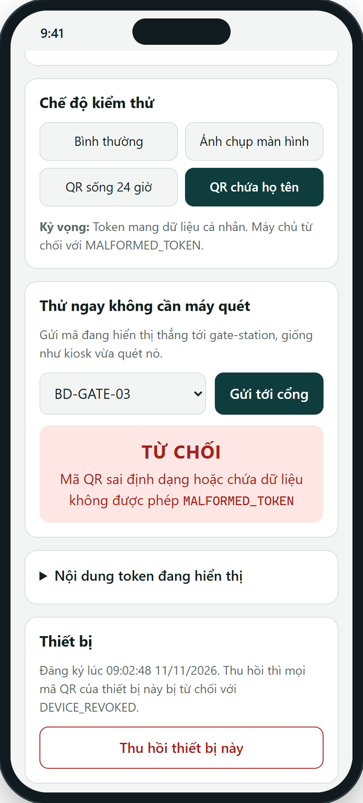 | 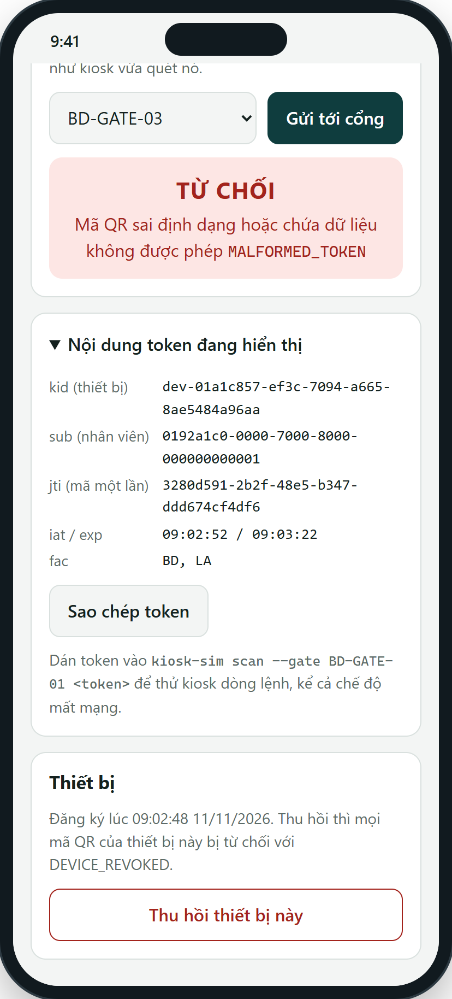 |
| *Hình 18.3.5* `QR_ALREADY_USED` | *Hình 18.3.6* `MALFORMED_TOKEN` | *Hình 18.3.7* Chỉ 6 claim, không có dữ liệu cá nhân |

<p align="center">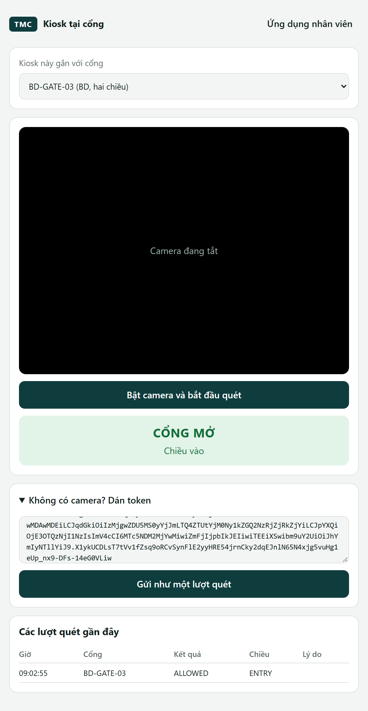</p>

*Hình 18.3.8 Trang kiosk web `/kiosk` mở cổng sau khi nhận mã QR (trang thử nghiệm; demo ADR-11 dùng `kiosk-simulator` dòng lệnh).*

| Vai trò | Màn hình |
| --- | --- |
| Bảo vệ: mở cổng thủ công với lý do bắt buộc, chỉ cổng được phân công | 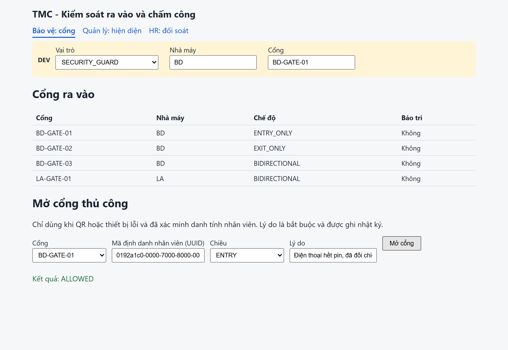<br>*Hình 18.3.9* |
| Quản đốc: ai đang ở trong nhà máy, trong phạm vi nhà máy của mình | 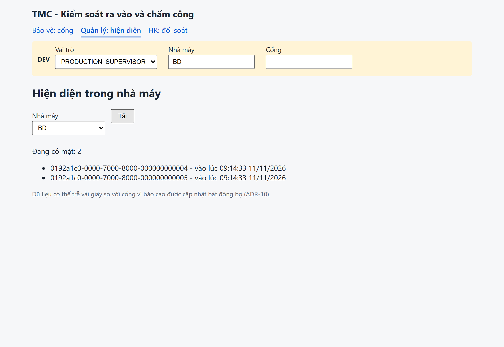<br>*Hình 18.3.10* |
| Quản trị hệ thống: theo dõi công đã đồng bộ sang HR/Payroll | 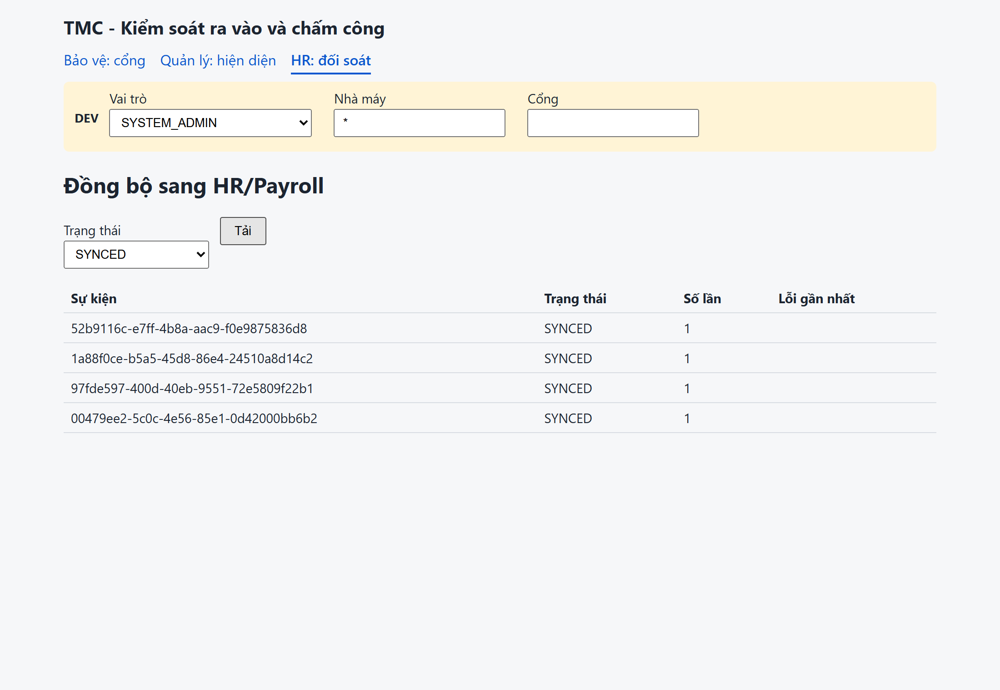<br>*Hình 18.3.11* |

Luồng đầy đủ của app nhân viên dạng ảnh động: [`employee-app-demo.gif`](../screenshots/employee-app-demo.gif).

---

## 18.4 Phần Team D: consumer trung tâm, tích hợp HR, audit và kiosk

### 18.4.1 Tích hợp HR/Payroll (`services/hr-integration`, D-06, D-07)

`hr-integration` nhận `attendance.AttendanceConfirmed` và `attendance.AttendanceCorrected` từ hàng đợi `tmc.hr.attendance` và gửi từng lượt sang HR/Payroll thành một **lô một dòng** theo `docs/api/hr-payroll.openapi.yaml`. Ba quy tắc chính: ghi lại dòng sẽ gửi vào `sync_log` trước khi gọi HR; kết quả không rõ thì **tra cứu trước, chỉ gửi lại khi HR xác nhận chưa nhận**; việc thử lại do job định kỳ làm, không chờ RabbitMQ giao lại thông điệp.

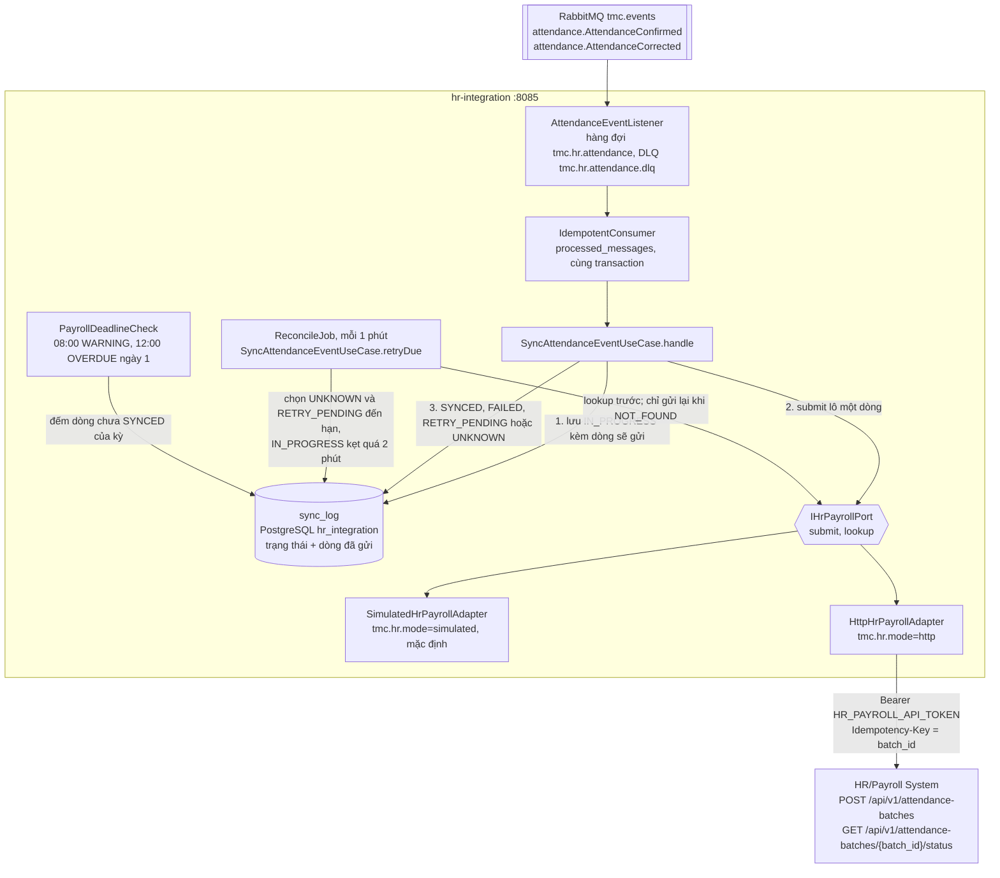

*Hình 18.4.1 Luồng đồng bộ HR/Payroll: consumer, `sync_log`, lô một dòng, tra cứu trước khi gửi lại và job đối soát (Team D).*

**Ánh xạ câu trả lời HTTP sang kết quả** (`HttpHrPayrollAdapter`, kiểm bằng `HttpHrPayrollAdapterTest.should_map_each_http_status_to_what_it_says_about_the_batch`):

| Câu trả lời của HR | Kết quả ở port | Trạng thái `sync_log` | Việc tiếp theo |
| --- | --- | --- | --- |
| 2xx trừ 207 | `ACCEPTED` | `SYNCED` | Xong |
| 422 | `REJECTED` | `FAILED` | Không gửi lại nguyên dạng |
| 4xx khác (401, 403, 400 ...) | `REFUSED` | `RETRY_PENDING`, log mức ERROR | HR chưa nhận lô; gửi lại sau khi sửa token hoặc cấu hình |
| 207, 5xx, timeout, lỗi mạng | `TIMEOUT` | `UNKNOWN` | Tra cứu `GET .../{batch_id}/status` trước khi gửi lại |

**Quy tắc và bằng chứng:**

| Quy tắc | Lớp | Bằng chứng |
| --- | --- | --- |
| Gửi một lần; sự kiện đã chốt không gửi lại | `SyncAttendanceEventUseCase` | `SyncAttendanceEventTest.should_mark_synced_when_hr_accepts`, `should_not_send_a_settled_event_again`, `HrAttendanceListenerIT.should_send_a_confirmed_attendance_to_hr_once` |
| HR không trả lời nghĩa là "chưa biết", không phải "thất bại" | như trên | `SyncAttendanceEventTest.should_mark_unknown_not_failed_when_hr_does_not_answer` |
| Tra cứu trước khi gửi lại; chỉ `NOT_FOUND` mới gửi lại, cùng `Idempotency-Key` | như trên | `SyncAttendanceEventTest.should_look_up_the_result_before_resending_an_unknown_event`, `should_resend_with_the_same_event_id_when_hr_confirms_not_found`, `should_keep_unknown_without_resending_when_lookup_is_inconclusive`; `HrRetryTest.should_resend_an_unknown_batch_later_only_after_hr_says_it_does_not_have_it`, `should_settle_an_unknown_batch_from_the_lookup_without_resending` |
| Thử lại không chờ thông điệp được giao lại; backoff 1, 2, 4 ... phút, tối đa 1 giờ | `HrReconcileConfig.ReconcileJob`, `SyncRecord.retryLater` | `HrRetryTest.should_keep_retrying_a_refused_batch_with_growing_delay_until_hr_takes_it`, `SyncLogPersistenceIT.should_pick_only_rows_due_for_a_retry` |
| Dòng `IN_PROGRESS` do tiến trình dừng giữa chừng được tra cứu, không gửi mù | như trên | `HrRetryTest.should_look_up_a_batch_left_in_progress_by_a_stopped_process` |
| Bản hiệu chỉnh là một dòng riêng: `event_id = correctionId`, `corrects_event_id` = lượt gốc | `SyncAttendanceEventUseCase`, `HttpHrPayrollAdapter` | `SyncAttendanceEventTest.should_send_a_correction_once_after_the_original_event_was_synced`, `HrRetryTest.should_send_a_correction_even_while_the_original_is_unknown`, `HttpHrPayrollAdapterTest.should_name_the_corrected_line_in_a_correction` |
| `sync_log` bền, lưu cả dòng đã gửi | `JdbcSyncLogRepository`, `V2__sync_log.sql` | `SyncLogPersistenceIT.should_store_and_read_back_every_field` |
| Cảnh báo hạn chót NFR-08: 08:00 `WARNING`, 12:00 `OVERDUE` ngày 1 (giờ `Asia/Ho_Chi_Minh`), chỉ ghi log | `PayrollDeadlineCheck` | `SyncAttendanceEventTest.should_raise_a_deadline_alert_before_noon_on_the_first_day_of_the_month`, `SyncLogPersistenceIT.should_let_the_deadline_alert_count_rows_from_the_database` |
| Chọn adapter bằng cấu hình: `tmc.hr.mode` mặc định `simulated` (dự án không có HR thật) kèm cảnh báo khi khởi động; giá trị lạ làm dừng khởi động | `HrIntegrationConfig` | `HrIntegrationConfigTest.should_select_simulated_adapter_by_default`, `should_select_http_adapter_when_http_mode_is_enabled` |

### 18.4.2 Read model hiện diện và cảnh báo gian lận R4 (`services/reporting`, D-04, D-05)

- **Một dòng cho mỗi lượt quét.** Bảng `attendance_projection` (`V2__presence.sql`) giữ một dòng theo `attemptId`, ghi trong **cùng transaction** với dấu `processed_messages`. Hiện diện của một nhân viên tại một nhà máy là lượt có `scannedAt` mới nhất, nên bản hiệu chỉnh của lượt **cũ hơn** không đè được lượt mới hơn; bản cũ hơn của cùng lượt đến trễ bị bỏ qua (so `aggregateVersion`). Bằng chứng: `ProjectionTest.should_not_let_a_correction_of_an_earlier_scan_override_a_later_scan`, `should_ignore_an_older_version_of_the_same_scan_that_arrives_late`, `should_apply_a_correction_event_on_top_of_the_original`, `should_process_a_redelivered_message_only_once`.
- **Bền và nguyên tử.** `PresencePersistenceIT.should_keep_presence_across_a_restart_of_reporting` (khởi động lại context, hiện diện còn) và `should_roll_back_the_projection_and_the_marker_when_the_handler_fails` (handler ném lỗi thì cả dòng read model lẫn dấu dedup đều không được ghi). `AttendanceEventListenerIT` kiểm luồng RabbitMQ đến bảng.
- **R4 di chuyển bất khả thi** (`ImpossibleTravelRule`, ADR-12): lượt vào một nhà máy cách lượt qua cổng ở nhà máy khác ít hơn `tmc.reporting.fraud.travel-window` (mặc định 60 phút) tạo một `FraudAlert` trong bảng `fraud_alerts` (`V3__fraud_alerts.sql`), mỗi lượt quét và quy tắc một lần, xem qua `GET /supervision/v1/alerts`. Lượt quét **không** bị xóa, để HR đối soát. Bằng chứng: `ProjectionTest.should_flag_two_entries_in_different_factories_ten_minutes_apart`, `should_not_flag_entries_in_two_factories_further_apart_than_the_travel_time`, `PresencePersistenceIT.should_store_an_impossible_travel_alert_once_and_keep_it_across_a_restart`.

### 18.4.3 Nhật ký kiểm toán chỉ thêm có chuỗi băm (`services/audit-admin`, D-08, ADR-16)

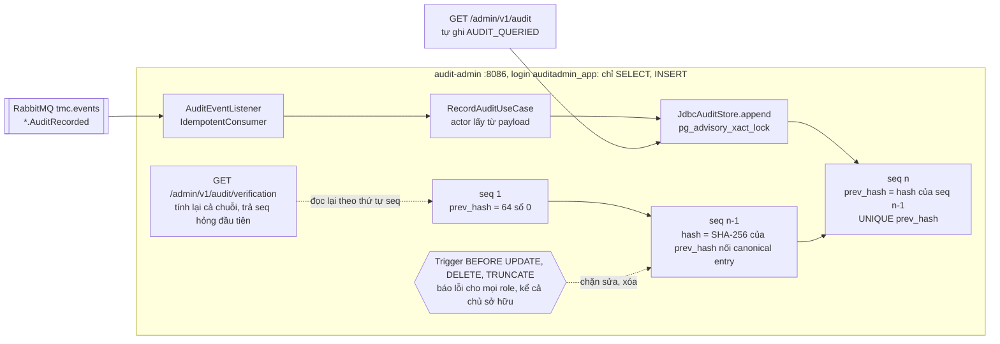

*Hình 18.4.2 Nhật ký audit trên PostgreSQL: login chỉ INSERT, trigger chặn sửa xóa, chuỗi băm tuần tự hóa bằng advisory lock (ADR-16, Team D).*

| Thuộc tính | Bằng chứng |
| --- | --- |
| Login của service chỉ `INSERT`, `SELECT`; bị từ chối `UPDATE`, `DELETE`, `TRUNCATE` | `AuditStoreIT.should_let_the_service_login_insert_and_read_but_never_change_history` |
| Chủ sở hữu bảng (login Flyway) cũng bị trigger chặn | `AuditStoreIT.should_stop_even_the_owner_from_updating_or_deleting` |
| 20 luồng ghi song song kèm ghi trùng vẫn giữ một chuỗi hợp lệ | `AuditStoreIT.should_keep_one_valid_chain_under_concurrent_writers_and_ignore_duplicates` |
| Superuser tắt trigger để sửa một dòng: kiểm tra chỉ ra đúng `seq` | `AuditStoreIT.should_detect_an_entry_rewritten_behind_the_service_back`, `AuditTest.should_detect_a_modified_entry_through_the_hash_chain` |
| Port không có hàm sửa hay xóa | `AuditTest.should_have_no_way_to_change_or_remove_history_through_the_store_port` (reflection) |
| Người thực hiện lấy từ trường `actor` của payload | `AuditTest.should_record_the_actor_sent_by_the_producer` |
| Chỉ `SYSTEM_ADMIN` kiểm chuỗi, và việc kiểm cũng được ghi audit | `AuditTest.should_let_only_the_system_admin_verify_the_chain_and_audit_the_check` |

### 18.4.4 Bằng chứng phía kiosk cho ADR-11 (P6) và ADR-12 (R2), cùng R4 ở trung tâm

| Mục | Kịch bản | Bằng chứng |
| --- | --- | --- |
| ADR-11, journal ghi trước | Mọi lượt quét vào journal trước khi hỏi Edge; không lưu token thô | `KioskAppTest.should_journal_before_asking_the_edge_and_hand_the_row_over_when_the_edge_answers`, `should_never_store_the_raw_token_in_the_journal` |
| ADR-11 P1 | Edge không trả lời: gửi lại cùng `attempt_id`; Edge báo `IN_PROGRESS` thì hỏi lại, rồi `PENDING`, không tự mở cổng | `KioskAppTest.should_retry_with_the_same_attempt_id_when_the_edge_does_not_answer`, `should_ask_again_with_the_same_attempt_id_while_the_edge_says_in_progress`, `should_settle_for_pending_when_the_edge_never_finishes_and_never_open_locally` |
| ADR-11 P6 | Mất LAN tới Edge: kiosk tự xác thực, mở qua Local Gate Link, ghi journal; có mạng lại thì giao theo thứ tự, không giao hai lần | `KioskAppTest.should_verify_locally_open_through_the_local_link_and_journal_when_the_edge_stays_down`, `should_hand_over_offline_rows_in_journal_order_when_the_edge_returns`, `should_not_double_hand_over_when_flush_runs_twice`, `should_keep_everything_in_the_journal_if_the_edge_is_still_down_on_flush`; `make demo-offline` |
| ADR-11 P5 | Gửi lại lượt chưa có kết quả bằng hash, không bằng token thô | `KioskAppTest.should_retry_an_unfinished_scan_with_the_hash_never_the_raw_token` |
| ADR-12 R2 | Cùng token đưa lại vào kiosk đang offline bị từ chối bằng replay cache cục bộ | `KioskAppTest.should_refuse_the_same_token_twice_offline_using_the_local_replay_cache`, `should_allow_the_token_again_after_the_replay_window_has_passed`; `make demo-offline` bước 4 |
| ADR-12, xác thực offline | Không mở khi chưa từng đồng bộ khóa, thiết bị đã thu hồi, token hết hạn, bị sửa hoặc rác; dùng cùng chính sách token với `user-qr` | `KioskAppTest.should_not_open_offline_when_no_keys_were_ever_synced`, `should_not_open_offline_for_a_device_revoked_in_the_last_sync`, `should_not_open_offline_for_an_expired_tampered_or_garbage_token`; `QrTokenPolicyContractTest` |
| D-15 | Offline: từ chối nhân viên `INACTIVE`, nhân viên chỉ thuộc `BD` bị từ chối ở kiosk `LA`; gói đồng bộ cũ không có `employees` giữ hành vi cũ | `KioskAppTest.d15_should_deny_an_inactive_employee_offline`, `d15_should_deny_at_la_and_allow_at_bd_for_a_bd_employee`, `d15_should_allow_a_valid_scan_with_a_legacy_bundle` |
| D-15, sửa sau nâng cấp | Chỉ đánh dấu có danh bạ sau một lần đồng bộ đủ; kiosk nâng cấp chưa có danh bạ thì kéo toàn bộ; nhà máy của cổng lấy từ gói đồng bộ, không suy từ tên; con trỏ đồng bộ là `generatedAt` của Edge | `KioskAppTest.should_mark_the_directory_present_only_after_a_complete_bundle`, `should_fetch_the_whole_directory_when_an_upgraded_kiosk_has_none_yet`, `should_take_the_factory_of_a_gate_from_the_bundle_not_its_name`, `should_use_the_edge_time_as_the_next_sync_cursor` |
| ADR-12 R4 | Cùng nhân viên vào hai nhà máy cách nhau 10 phút tạo cảnh báo | mục 18.4.2 |

### 18.4.5 Xác thực ở ba service trung tâm và hai ứng dụng web (D-13), DLQ (D-03)

- `reporting`, `hr-integration`, `audit-admin` kiểm JWT của identity qua JWKS bằng `PrincipalResolver`; header dev chỉ được tin ở profile `local`, `inmem`. Thiếu token hoặc token sai trả `401 UNAUTHENTICATED`; token hợp lệ nhưng không đủ quyền trả `403`. Bằng chứng: `BearerTokenApiTest` ở cả ba service.
- `apps/web-portal` có trang đăng nhập với identity (hiện ô TOTP khi identity trả `MFA_REQUIRED`), gửi `Authorization: Bearer` ở mọi lời gọi, nhận `401` thì quay về đăng nhập (`apps/web-portal/src/lib/auth.test.ts`). `apps/employee-app` gửi Bearer tới `user-qr` (`apps/employee-app/src/lib/api.test.ts`).
- Mỗi hàng đợi consumer có DLQ `<hàng đợi>.dlq`, thử lại 3 lần. `DlqMonitor` ở cả ba service công bố gauge `tmc.rabbitmq.dlq.depth` theo tên hàng đợi và ghi log `WARN` khi DLQ có thông điệp. Có IT cho phần theo dõi này ở `hr-integration`: `HrAttendanceListenerIT.should_park_a_message_that_keeps_failing_in_the_dead_letter_queue`.

Các giới hạn của từng mục trên (chưa có luật lặp từ chối, chưa phát `AuditRecorded` cho cảnh báo, chưa có tài khoản bảo vệ trong identity, chưa có refresh token, truy vấn audit 5 giây và lưu 12 tháng chưa làm, demo chưa chạy trên Docker đầy đủ) được liệt kê ở [08-limitations.md](08-limitations.md).
