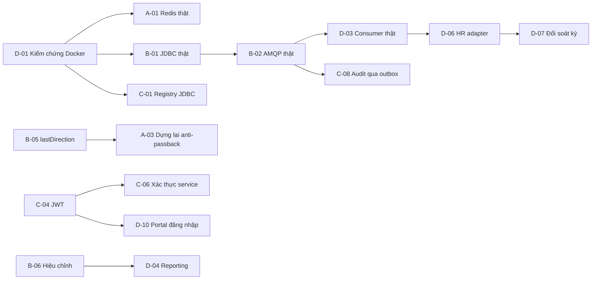

# Phân chia công việc M2 (4 team, mỗi team 2 người)

Tài liệu này là nguồn sự thật duy nhất về **ai làm gì, theo thứ tự nào, xong khi nào**. Mọi thay đổi phân công phải sửa ở đây trong một PR riêng (`docs(team): ...`) và báo trong buổi họp nhóm.

> **Cần điền trước tuần 1:** hạn nộp M2 chính thức (đề bài không ghi ngày). Điền vào bảng mốc ở mục 3, các mốc W1 đến W4 bên dưới là tương đối so với ngày bắt đầu.

## 1. Bốn team và quyền sở hữu

Nguyên tắc chia: **theo bounded context** (ADR-01), không theo actor. Mỗi thư mục chỉ có **một team chủ sở hữu**; team khác muốn sửa phải mở PR và được team chủ sở hữu duyệt (xem `CODEOWNERS`).

| Team | Thành viên | Sở hữu mã nguồn | Sở hữu tài liệu báo cáo |
| --- | --- | --- | --- |
| **A. Gate Station** | `<Tên A1 (lead)>`, `<Tên A2>` | `services/gate-station`, `simulators/turnstile-simulator` | Mục 12.4, 13.1 (luồng quét QR), 16.2, 16.3 (API Kiosk, Turnstile), ADR-13 |
| **B. Attendance** | `<Tên B1 (lead)>`, `<Tên B2>` | `services/attendance` | ADR-11, máy trạng thái, mô hình dữ liệu, mục 12.5, 12.7 (Outbox, nhất quán), phần "Issues Encountered: mất kết nối" |
| **C. User/QR và Identity** | `<Tên C1 (lead)>`, `<Tên C2>` | `services/user-qr`, `services/identity`, `simulators/device-simulator`, `platform/security` | ADR-08, ADR-09, ADR-12, NFR-03/04/05, phần "Issues Encountered: QR tĩnh" |
| **D. Kiosk, Portal và Central** | `<Tên D1 (lead)>`, `<Tên D2>` | `simulators/kiosk-simulator`, `apps/web-portal`, `services/reporting`, `services/hr-integration`, `services/audit-admin`, `.github`, `docker`, `scripts` | Mục 13.2, 15, 16.4 (HR, triển khai), ma trận truy vết, tích hợp và biên tập báo cáo cuối |

Dùng chung (cả bốn team phải duyệt thay đổi): `platform/common-kernel`, `platform/messaging`, `platform/test-support`, `docs/api`, `docs/adr`. Quy tắc ở `CONTRIBUTING.md`.

### Vai trò trong mỗi cặp

| Vai trò | Trách nhiệm |
| --- | --- |
| Lead | Chia nhỏ việc của team thành issue, giữ cam kết với team khác, đại diện team trong họp, là reviewer cuối cho thư mục của team |
| Đối ứng (pair) | Làm song song, review chéo mọi PR của lead (không tự merge PR của chính mình), thay lead khi vắng |

Hai người trong một team **luôn review PR của nhau**; thêm **một reviewer thuộc team khác** cho PR chạm vào hợp đồng (API, event, port). Xem `docs/conventions/pr-review-checklist.md`.

## 2. Hiện trạng scaffold (đã làm sẵn, đã kiểm chứng)

Số liệu lấy từ lần chạy test gần nhất trên máy tạo scaffold. Test đánh dấu "bỏ qua" là các việc còn lại ghi trong mục 4 (mỗi cái có `@Disabled("TODO Team X ...")` kèm tiêu chí).

| Module | Test chạy | Bỏ qua (TODO) | Mức hoàn thiện |
| --- | --- | --- | --- |
| `platform/*` | 10 | 0 | Hoàn chỉnh cho M2 |
| `services/attendance` | 28 | 0 | Sâu: máy trạng thái, outbox, nhập offline, phục hồi, đối soát. Chưa chạy được với Docker |
| `services/user-qr` | 19 | 0 | Sâu: xác thực JWS, thiết bị, thu hồi, gói đồng bộ |
| `services/gate-station` | 47 | 0 | Sâu: điều phối 7 bước, chính sách, anti-passback, turnstile ACL, mở thủ công |
| `simulators/*` | 30 | 0 | Hoàn chỉnh, đã chạy 3 kịch bản demo trên stack thật |
| `services/reporting` | 9 | 3 | Khung và hiện diện |
| `services/hr-integration` | 10 | 3 | Khung và luồng từng sự kiện |
| `services/audit-admin` | 9 | 2 | Khung, nhật ký chỉ thêm |
| `services/identity` | 13 | 4 | Khóa tài khoản và MFA, chưa cấp JWT |
| `apps/web-portal` | 5 (vitest) | 0 | Khung 3 trang, build và lint sạch |

**Chưa kiểm chứng:** mọi thứ cần Docker (PostgreSQL, Redis, RabbitMQ): adapter JDBC, Redis, AMQP, Flyway, listener của consumer, `PersistenceAndBrokerIT`. Máy tạo scaffold không bật được Docker. Việc kiểm chứng đầu tiên của tuần 1 là mục **D-01**.

## 3. Mốc thời gian

| Mốc | Tuần | Điều kiện hoàn thành (kiểm tra được) |
| --- | --- | --- |
| **M-0 Khởi động** | W1 ngày 1 | Mọi người chạy được `make local-up` và `make demo-online`; đã nhận issue |
| **M-1 Hợp đồng đóng băng** | W1 cuối | OpenAPI và AsyncAPI trong `docs/api` khớp mã; không đổi hợp đồng nếu chưa có ADR |
| **M-2 Hạ tầng thật chạy** | W2 giữa | `make up` + `make integration` xanh; 3 demo chạy với PostgreSQL, Redis, RabbitMQ |
| **M-3 Tính năng đủ** | W3 cuối | Mọi story mức Bắt buộc ở mục 4 xong; không còn test `@Disabled` mức Bắt buộc |
| **M-4 Đóng băng mã** | W4 giữa | Chỉ còn sửa lỗi; báo cáo bản nháp đầy đủ |
| **M-5 Nộp** | `<điền hạn>` | Báo cáo PDF + URL GitHub trên LMS, theo `docs/runbook/release-checklist.md` |

Hạn nộp thực tế phải lùi lại 2 ngày so với M-5 để dự phòng.

## 4. Backlog theo team

**Mức:** `B` = Bắt buộc cho M2 (đề bài hoặc ADR yêu cầu), `N` = Nên có, `T` = Tùy thời gian. **Cỡ:** S ≤ 0,5 ngày, M ≈ 1 đến 2 ngày, L ≈ 3 ngày trở lên (tính cho một người). **Phụ thuộc** là ID story phải xong trước.

### Team A: Gate Station

| ID | Story | Mức | Cỡ | Phụ thuộc | Tiêu chí hoàn thành |
| --- | --- | --- | --- | --- | --- |
| A-01 | Chạy `RedisTokenReservation` và `RedisAntiPassbackStore` với Redis thật; thêm test tích hợp Testcontainers (thẻ `integration`) | B | M | D-01 | Test: hai luồng cùng `reserve` một `jti` chỉ một bên thắng; pending slot chặn quét song song; khởi động lại Redis vẫn giữ `USED` (AOF bật) |
| A-02 | **Đồng bộ anti-passback sau nhập offline:** sau `ingestOffline` thành công, cập nhật `last` của nhân viên ở `IAntiPassbackStore` (hiện chưa làm, xem `docs/architecture/implementation-notes.md` mục 3) | B | M | none | Test: quét offline `ENTRY` rồi flush, sau đó quét online `ENTRY` ở cổng một chiều bị `ANTI_PASSBACK_VIOLATION` |
| A-03 | Dựng lại `last` từ Attendance khi cache lạnh (Redis mất) để không bị lách anti-passback | B | M | B-05, A-01 | Test: xóa key Redis, quét lần hai cùng chiều vẫn bị từ chối |
| A-04 | Gate Store bằng PostgreSQL + Flyway thay `InMemoryGateConfigRepository` (FR-11 đến FR-13, FR-16); API quản trị cổng cho `SYSTEM_ADMIN` | B | L | D-01 | CRUD cổng có Rbac, mọi thay đổi ghi audit; bảo trì cổng đổi `acceptsScans` ngay |
| A-05 | `HttpTurnstileAdapter`: thêm test hợp đồng với `turnstile-simulator` thật (không chỉ JDK HttpServer); đo độ trễ | N | S | none | Test chạy chống simulator, ngân sách 800 ms được kiểm |
| A-06 | Phản hồi `replay` trả luôn `direction` (hiện `null`, xem implementation-notes mục 5) | N | S | B-04 | Retry nhận lại đủ chiều như lần đầu |
| A-07 | Cảnh báo anti-passback và mất tín hiệu kiosk cho Guard Console (FR-14, FR-15, FR-18) qua SSE; ngưỡng `offline > 60 s` (AC-11) | N | L | D-04 | Guard thấy cảnh báo trong 5 giây |
| A-08 | Callback `onPhysicalPassCompleted` từ turnstile (tùy phần cứng) để xác nhận người đã qua cổng | T | M | A-05 | Có thể bật bằng cấu hình, không bật thì hành vi cũ |
| A-09 | Kiểm thử tải 800 lượt/30 phút (NFR-06): p95 ≤ 1,0 s, p99 ≤ 2,0 s với `SimulatedTurnstileAdapter` | B | M | M-2 | Báo cáo đo kèm lệnh chạy lại, đính kèm báo cáo cuối |

### Team B: Attendance

| ID | Story | Mức | Cỡ | Phụ thuộc | Tiêu chí hoàn thành |
| --- | --- | --- | --- | --- | --- |
| B-01 | Chạy migration Flyway và `PersistenceAndBrokerIT` với Docker; sửa lỗi nếu có | B | M | D-01 | `./gradlew :services:attendance:integrationTest` xanh |
| B-02 | Thêm test tích hợp AMQP: Outbox publisher thật đẩy lên RabbitMQ, ngắt broker, bật lại, không mất sự kiện (ADR-11 test 4 trên hạ tầng thật) | B | M | B-01 | Test xanh, sự kiện đủ và đúng thứ tự |
| B-03 | Ghi nhận offline: chuyển các `anomaly` thành hàng đợi xử lý của HR (UC-09) và sự kiện `AuditRecorded` đã có; thêm truy vấn `IAttendanceQuery.anomalies` | B | M | none | HR liệt kê được bản ghi bất thường chờ xử lý |
| B-04 | Mở rộng `IAttendanceQuery`: trả `direction` và `employeeUuid` trong `AttemptView` (phục vụ A-06) | N | S | none | Hợp đồng cập nhật trong `docs/api` |
| B-05 | `IAttendanceQuery.lastDirection(employee)` để Gate Station dựng lại anti-passback (phục vụ A-03) | B | S | none | Test dùng bảng `attendance_transactions` |
| B-06 | `AttendanceCorrected`: hiệu chỉnh có kiểm soát bởi HR (FR-26), giữ liên hệ với giao dịch gốc, tăng `aggregateVersion` | B | L | B-03 | Test: hiệu chỉnh phát sự kiện mới; Reporting và HR nhận được |
| B-07 | Xác minh lượt mở thủ công (`MANUAL`) bởi HR để trở thành công hợp lệ (FR-20, UC-06 bước cuối) | N | M | B-06 | Lượt thủ công đã xác minh sinh `AttendanceConfirmed` |
| B-08 | Chỉ số vận hành: tồn đọng outbox > 5 phút, số lượt `GATE_UNKNOWN` (AC-11) qua Micrometer | N | S | none | Metric xuất hiện ở `/actuator` |
| B-09 | Thêm `RecoveryPolicy` cấu hình được qua bảng tham số quản trị (FR-32) | T | S | none | Đổi tham số không cần build lại |

### Team C: User/QR và Identity

| ID | Story | Mức | Cỡ | Phụ thuộc | Tiêu chí hoàn thành |
| --- | --- | --- | --- | --- | --- |
| C-01 | Chạy Flyway và `JdbcDeviceKeyRegistry` với Docker; thêm test tích hợp, kể cả ràng buộc "một thiết bị ACTIVE mỗi nhân viên" ở mức DB | B | M | D-01 | Đăng ký hai thiết bị song song: một bên bị từ chối bởi chỉ mục duy nhất |
| C-02 | **Gói đồng bộ có nhân viên đủ quyền** (`IEmployeeDirectory` của Gate Station hiện chỉ đọc từ cấu hình): thêm `employees` (uuid, active, factories) vào `ISyncBundle` và `IKioskSyncSource` | B | L | none | Gate Station dùng dữ liệu đồng bộ thay vì seed trong yml |
| C-03 | Hồ sơ nhân viên và vòng đời (FR-01 đến FR-04, FR-07, FR-09, FR-10), đồng bộ từ HR (FR-08); vô hiệu hóa nhân viên thì thu hồi thiết bị | B | L | C-01 | UC-01, UC-02, UC-03 chạy được; thao tác ghi audit |
| C-04 | Identity: cấp JWT ES256 (Nimbus), `/.well-known/jwks.json`, hết hạn phiên 15 phút (NFR-03) | B | L | none | Test: token hết hạn bị từ chối; JWKS xoay khóa được |
| C-05 | TOTP thật cho MFA (HR Staff, System Admin), thay `IMfaVerifier` luôn từ chối | B | M | C-04 | Test mã đúng, sai, lệch thời gian |
| C-06 | Thay `PrincipalHeaders` bằng xác thực JWT trực tiếp ở các service (hoặc cấu hình gateway chèn header đã ký) | B | M | C-04 | Gọi không có token bị 401; header giả bị bỏ qua |
| C-07 | Quản lý tài khoản và phân quyền (FR-31, UC-12): thay đổi vai trò kết thúc phiên đang mở | N | L | C-04 | Test phiên bị thu hồi ngay |
| C-08 | Chuyển audit của user-qr và identity qua outbox sang audit-admin (thay `LoggingAuditLog`) | B | M | B-02 | Audit đến được audit-admin, không mất khi broker tắt |
| C-09 | `device-simulator`: thêm lệnh `revoke` và `rotate` để demo thu hồi | T | S | none | Dùng được trong kịch bản demo |
| C-10 | Tài liệu bảo mật: mô hình đe dọa QR (STRIDE ngắn), `privacy-notes.md`, mã hóa lưu trữ | B | M | none | Phần "QR tĩnh" của báo cáo có bảng mối đe dọa và biện pháp |

### Team D: Kiosk, Portal và Central

| ID | Story | Mức | Cỡ | Phụ thuộc | Tiêu chí hoàn thành |
| --- | --- | --- | --- | --- | --- |
| D-01 | **Kiểm chứng hạ tầng Docker đầu tiên:** `make up`, `make integration`, chạy 3 demo với PostgreSQL, Redis, RabbitMQ; ghi lỗi vào issue cho team chủ sở hữu | B | M | none | Danh sách lỗi tồn tại hoặc xác nhận "xanh" trong `docs/runbook/troubleshooting.md` |
| D-02 | CI GitHub Actions: build, test, ArchUnit, spotless, portal; job tích hợp riêng (Testcontainers) | B | M | none | PR đầu tiên chạy xanh; nhánh `main` bảo vệ theo `CONTRIBUTING.md` |
| D-03 | Consumer thật: `JdbcProcessedMessageStore` (bảng `processed_messages`, cùng transaction với read model), DLQ và chính sách retry cho reporting, hr-integration, audit-admin | B | L | B-02 | Gửi trùng thông điệp không nhân đôi kết quả; thông điệp lỗi vào DLQ |
| D-04 | Reporting: lọc theo nhóm/ca (cần `group` trong sự kiện, phối hợp B), báo cáo chuyên cần, xuất file (FR-24, FR-28), dashboard (FR-25) | B | L | B-06 | UC-10 các luồng chính chạy; Supervisor chỉ thấy nhóm của mình |
| D-05 | Reporting: quy tắc gian lận R4 (`ImpossibleTravelRule`, `RepeatedDenialRule`) và cảnh báo (ADR-12 test 8) | B | M | D-03 | Test: BD rồi LA cách 10 phút sinh cảnh báo và cờ bất thường |
| D-06 | HR Integration: `HttpHrPayrollAdapter` theo hợp đồng mục 16.4 đã sửa, tra cứu kết quả trước khi gửi lại `UNKNOWN`, scheduler retry có backoff | B | L | D-03 | Test với HR giả: timeout rồi tra cứu rồi không gửi trùng |
| D-07 | HR Integration: đối soát kỳ, lô chốt, cảnh báo 08:00 và 12:00 ngày 1 (NFR-08, UC-09) | B | L | D-06 | Test dùng đồng hồ giả; dữ liệu đủ trước hạn |
| D-08 | Audit: lưu trữ PostgreSQL chỉ INSERT (role không có UPDATE/DELETE), chuỗi băm, truy vấn ≤ 5 giây, lưu 12 tháng (NFR-02) | B | M | C-08 | Test quyền DB và phát hiện sửa dữ liệu |
| D-09 | `kiosk-simulator`: kịch bản sự cố P1 đến P5 tự động (không chỉ P6) dùng edge giả có chèn lỗi, ghi vào báo cáo | N | M | none | Bảng "điểm đứt → kết quả" kèm lệnh chạy |
| D-10 | `web-portal`: đăng nhập thật qua identity, Guard Console có cảnh báo trực tiếp, trang đối soát đầy đủ | N | L | C-04, A-07 | Hết thanh DEV, dùng JWT |
| D-11 | Hạ tầng triển khai: Dockerfile cho từng service và profile `apps` trong compose; tài liệu mTLS giữa kiosk và Edge Gateway | T | L | D-01 | `docker compose --profile apps up` chạy cả stack |
| D-12 | **Tích hợp báo cáo:** cập nhật `docs/document.md` theo `docs/adr/README.md` mục 3, thêm mục "Issues Encountered", phản ánh, mục Task 2 | B | L | mọi team nộp phần của mình | Báo cáo PDF hoàn chỉnh theo `release-checklist.md` |

## 5. Hợp đồng giữa các team (phải thống nhất trước khi code song song)

| Hợp đồng | Bên cung cấp | Bên dùng | Nơi định nghĩa | Ai duyệt khi đổi |
| --- | --- | --- | --- | --- |
| `IAttendanceCommand`, `IAttendanceQuery`, `IOfflineAttendanceIngest` (REST `/internal/v1/**`) | B | A | `docs/api/internal-attendance.openapi.yaml` | A và B |
| `AttendanceEvents` (AMQP) | B | D | `docs/api/attendance-events.asyncapi.yaml` | B và D |
| `IQRValidation` (`/internal/v1/qr/verify`), sync bundle (`/internal/v1/sync-bundle`) | C | A, D | `docs/api/user-qr.openapi.yaml` | A và C |
| Kiosk API (`/kiosk/v1/**`) | A | D (kiosk-simulator) | `docs/api/kiosk-edge.openapi.yaml` | A và D |
| `ITurnstileControlPort` và API turnstile | A | A | `docs/api/turnstile.openapi.yaml` | A |
| Quan sát cổng (`/internal/v1/attempts/{id}/gate-observation`) | A | B | `docs/api/kiosk-edge.openapi.yaml` (mục internal) | A và B |
| Header danh tính (`X-Subject`, `X-Roles`, `X-Scope-*`) | C (sau này JWT) | tất cả | `docs/conventions/api-design-guidelines.md` | C |

**Quy tắc:** hợp đồng đổi thì sửa tệp `docs/api` **trong cùng PR** với mã, và thêm reviewer của bên dùng. Đổi không tương thích phải có ADR.

## 6. Đồ thị phụ thuộc chính (đường găng)

**Việc chặn nhiều team nhất:** D-01 (tuần 1) và B-02 (tuần 2). Hai việc này phải xong sớm; nếu trễ, báo ngay trong họp.

## 7. Kế hoạch từng tuần

| Tuần | Mục tiêu | A | B | C | D |
| --- | --- | --- | --- | --- | --- |
| **W1** | Chạy được, đóng băng hợp đồng | A-05, rà OpenAPI | B-04, B-05, rà OpenAPI | C-10, C-04 bắt đầu | **D-01**, D-02, rà AsyncAPI |
| **W2** | Hạ tầng thật | A-01, A-04 bắt đầu | B-01, **B-02**, B-03 | C-01, C-04, C-02 bắt đầu | D-03, D-09 |
| **W3** | Tính năng đủ | A-02, A-03, A-04, A-09 | B-06, B-08 | C-02, C-03, C-05, C-06, C-08 | D-04, D-05, D-06, D-07, D-08 |
| **W4** | Đóng băng, báo cáo | A-06, A-07 nếu kịp | B-07 nếu kịp | C-07 nếu kịp | **D-12**, D-10 nếu kịp, mọi team nộp phần báo cáo |

Việc mức `N` và `T` bị cắt đầu tiên khi trễ. Quyết định cắt do lead các team họp và ghi vào `MEETING-CADENCE.md` mục "Nhật ký quyết định".

## 8. Phân công viết báo cáo

Báo cáo nộp là **tài liệu M1 đã sửa + phần M2**. Mỗi team viết phần của mình bằng Markdown trong `docs/report/` (thư mục do Team D tạo ở D-12), Team D hợp nhất.

| Phần | Nội dung | Team viết | Hạn nộp bản nháp |
| --- | --- | --- | --- |
| Issues Encountered: mất kết nối | Vấn đề, 7 điểm đứt, cơ chế (ADR-11), cách giảm thiểu, vị trí trong từng view, đánh đổi, bằng chứng (test và demo) | B (viết), A và D (bổ sung bằng chứng) | W3 giữa |
| Issues Encountered: QR tĩnh | Mối đe dọa, QR động ký bằng khóa thiết bị (ADR-12), chống replay nhiều lớp, đánh đổi | C (viết), A và D (bằng chứng) | W3 giữa |
| Cập nhật yêu cầu, use case, đặc tính | NFR-05, NFR-09, UC-07, UC-08, AC-03, AC-04 theo `docs/adr/README.md` mục 3 | C (NFR-05, UC-07), B (NFR-09, UC-08) | W3 giữa |
| Component, sequence, deployment | Sơ đồ mới hoặc đã sửa (Kiosk Journal, Replay Cache, Device Key Registry, thành phần điều phối) | A (quét QR, 15.2), B (outbox), C (bảo mật), D (HR) | W3 cuối |
| Áp dụng SOLID | Mỗi nguyên tắc gắn với lớp thật trong mã (dùng `docs/architecture/solid-map.md`) | Cả bốn, mỗi team phần mã của mình | W3 cuối |
| Phản ánh (Reflection) | Mỗi team một đoạn: SOLID giúp gì, khó khăn gì, bằng chứng từ mã | Cả bốn, D hợp nhất | W4 đầu |
| Task 2: hiện thực | Module đã chọn (Attendance Event Recording tại biên), cách chạy, ảnh kết quả test và demo, URL GitHub | D | W4 giữa |
| Hợp nhất, ma trận truy vết, định dạng | Một giọng văn, đánh số hình, danh mục hình, tài liệu tham khảo | D | W4 giữa |

Quy tắc viết: **mọi khẳng định về hành vi phải trỏ tới một test hoặc một kịch bản demo** (tên lớp test hoặc `make demo-*`). Không viết điều mà mã chưa làm; việc chưa làm ghi vào mục "Hạn chế và việc tiếp theo".

## 9. Định nghĩa "xong" cho một story

1. Mã theo `docs/conventions/coding-standards.md`, `./gradlew spotlessCheck` sạch.
2. Có test theo `docs/conventions/testing-strategy.md`; test mới viết **trước hoặc cùng lúc** với mã, không bỏ sau.
3. `ArchitectureTest` của service vẫn xanh (không phá quy tắc phụ thuộc).
4. Hợp đồng đổi thì `docs/api` đổi trong cùng PR.
5. Quyết định kiến trúc mới thì có ADR (`docs/adr/ADR-template.md`).
6. PR được duyệt đủ người theo checklist, CI xanh.
7. Tiêu chí hoàn thành của story ở bảng trên được chứng minh trong mô tả PR (lệnh đã chạy hoặc ảnh chụp).
